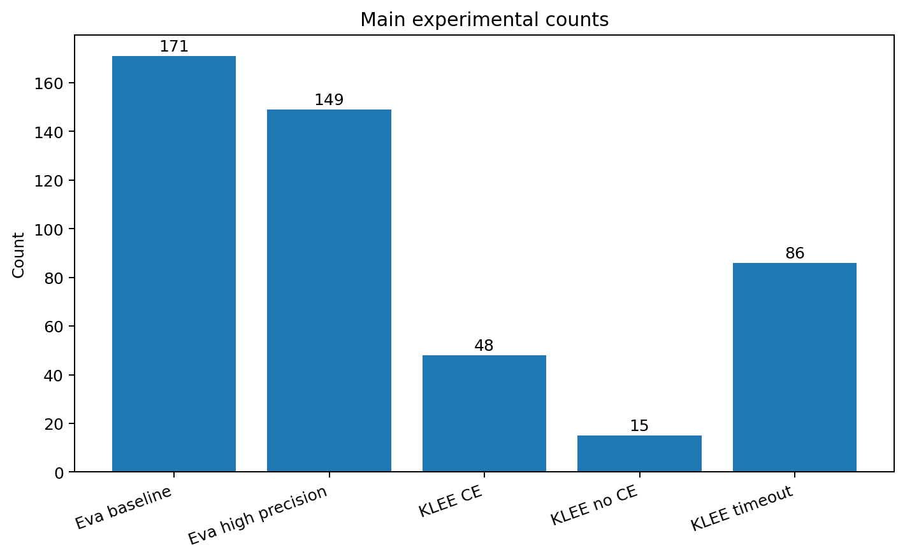
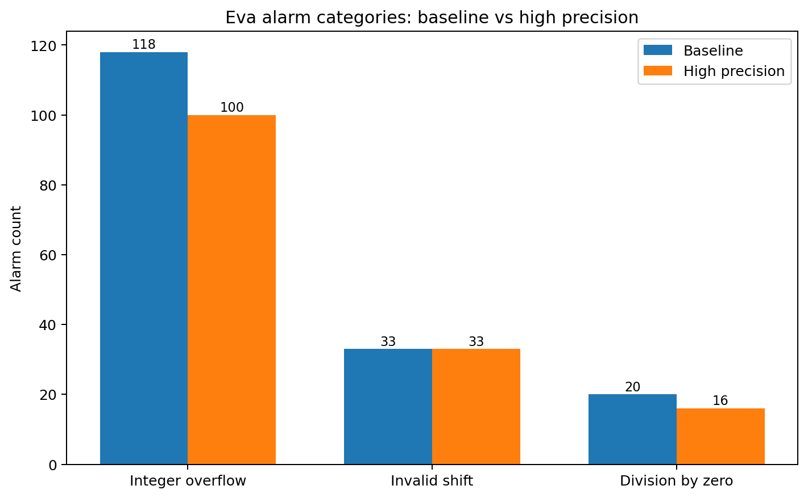
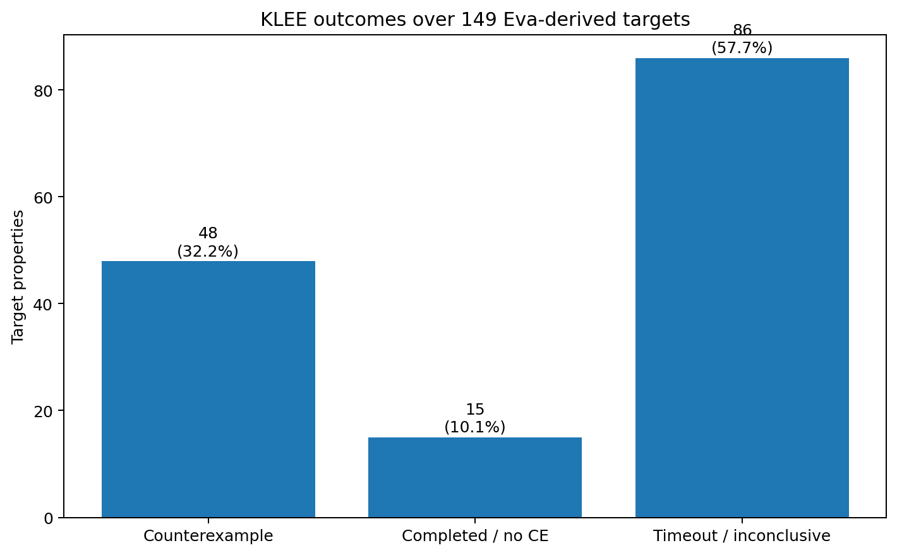
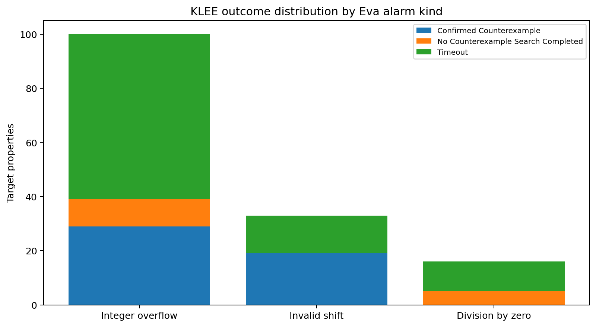
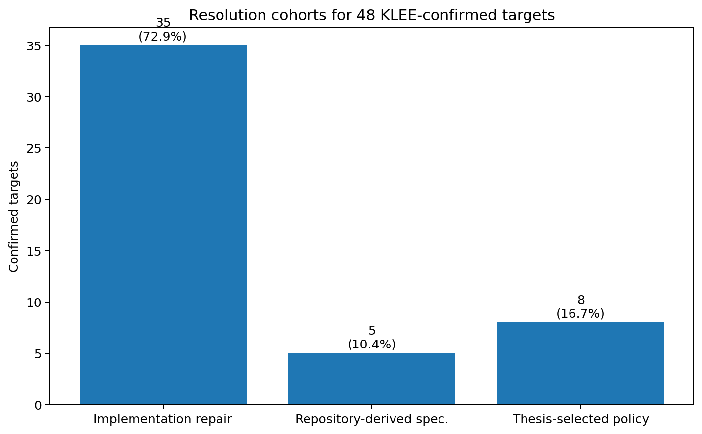
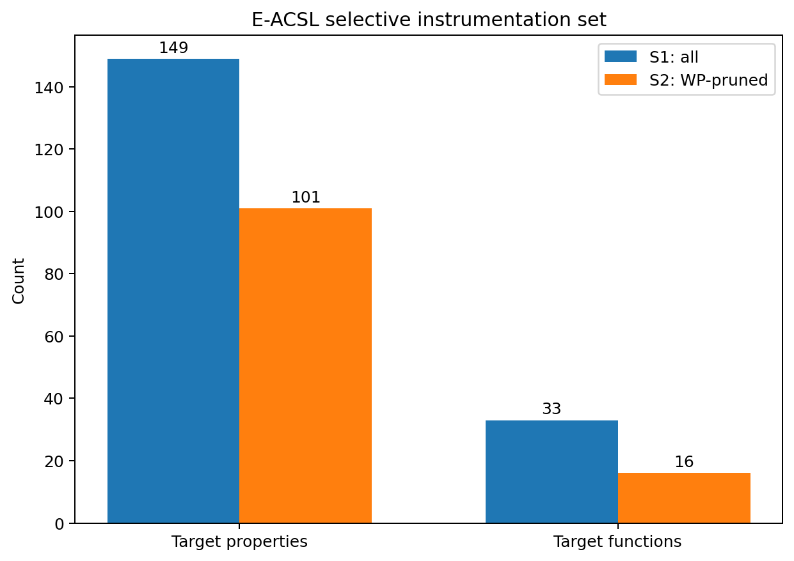
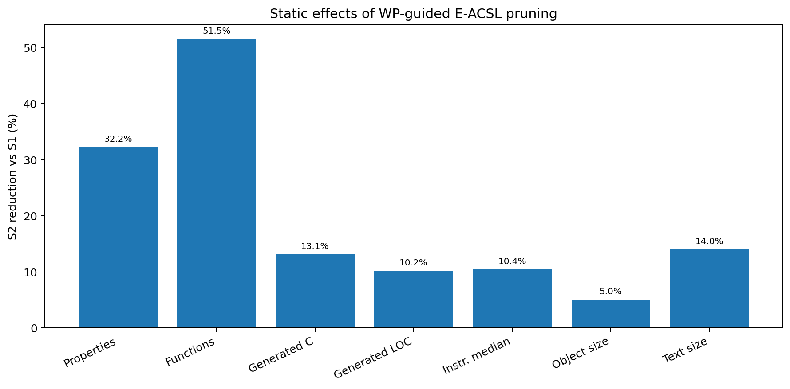
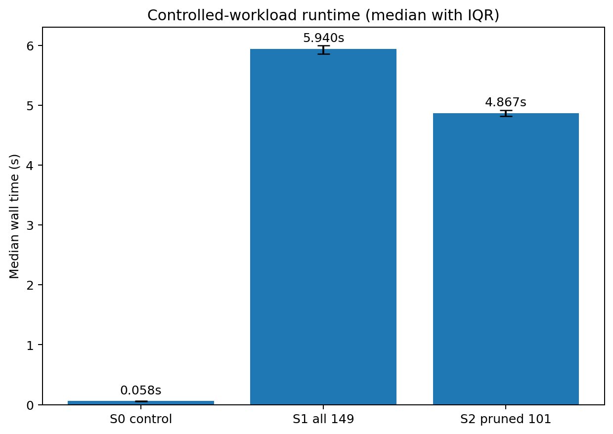
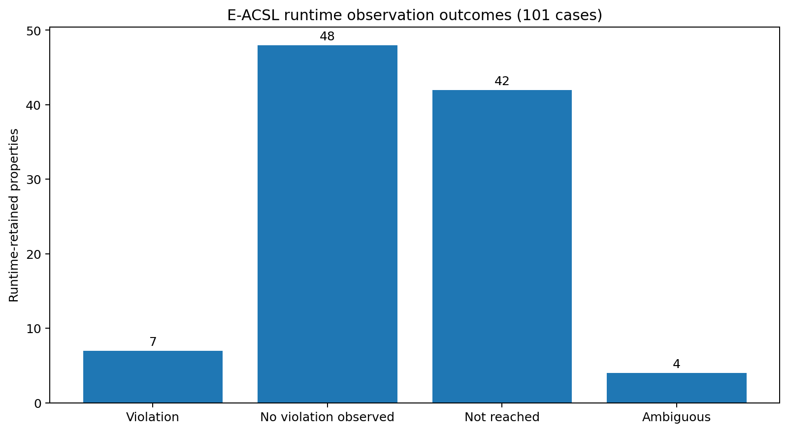
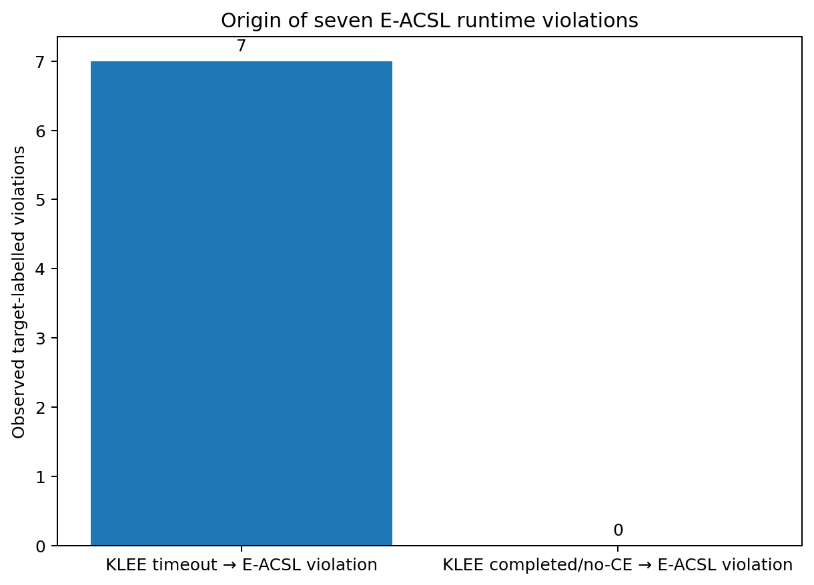

# گزارش جامع فنی، تحلیلی و مفهومی فرایند Eva → KLEE → Repair/Specification → WP → Selective E-ACSL

> **کاربرد این سند:** این متن یک «مرجع استنتاج برای نگارش پایان‌نامه» است، نه نسخه‌ی نهایی فصل‌بندی‌شده‌ی پایان‌نامه. هدف آن این است که تمام منطق، تنظیمات، داده‌ها، تصمیم‌ها، نتایج، محدودیت‌ها، جدول‌ها و نمودارهای لازم را در یک جا جمع کند تا بتوان از هر قسمت، متناسب با ساختار فصل‌های پایان‌نامه، متن نهایی استخراج کرد.

---

## 0. خلاصه‌ی بسیار فشرده‌ی کل پژوهش

در این پروژه، 46 تابع C عمدتاً مرتبط با محاسبات fixed-point، ضرب، تقسیم، high-pass، average و rotate با یک workflow چندمرحله‌ای بررسی شده‌اند. منطق اصلی workflow این بوده است که **هیچ ابزار به‌تنهایی به‌عنوان داور نهایی همه‌ی alarmها در نظر گرفته نشود** و نوع شواهد هر ابزار حفظ شود:

1. **Eva** مجموعه‌ای از رخدادهای بالقوه‌ی ناامن را با abstract interpretation تولید می‌کند.
2. با **افزایش precision Eva** بخشی از هشدارهای ناشی از از‌دست‌رفتن دقت حذف می‌شوند.
3. هر alarm باقی‌مانده به یک property دقیق و occurrence-aware تبدیل می‌شود.
4. **KLEE** برای هر property تلاش می‌کند یک witness concrete بسازد.
5. اگر KLEE counterexample بسازد، آن property وارد مرحله‌ی **semantic resolution** می‌شود؛ یعنی ابتدا باید مشخص شود رفتار صحیح چیست، سپس repair یا specification انجام شود.
6. property اصلی Eva حفظ می‌شود و **WP** دقیقاً همان property را بعد از resolution اثبات می‌کند.
7. propertyهایی که WP ثابت کرده، از **runtime instrumentation با E-ACSL** حذف می‌شوند؛ propertyهای حل‌نشده برای runtime monitoring باقی می‌مانند.
8. تأثیر این pruning هم به‌صورت **static** و هم **dynamic** اندازه‌گیری می‌شود.
9. E-ACSL برای بخشی از propertyهایی که KLEE روی آن‌ها timeout شده بود، violation concrete مشاهده می‌کند و مکمل بودن دو روش نشان داده می‌شود.

خلاصه‌ی کمی:

| مرحله | نتیجه |
|---|---:|
| توابع in-scope | 46 |
| Eva baseline alarms | 171 |
| Eva high-precision alarms | 149 |
| حذف‌شده با precision بیشتر | 22 (12.865497%) |
| KLEE counterexample | 48 |
| KLEE completed / no counterexample | 15 |
| KLEE timeout / inconclusive | 86 |
| propertyهای materialized به ACSL | 149/149 |
| resolution برای KLEE-confirmed | 48/48 |
| WP-valid target properties | 48/48 |
| E-ACSL S1 | 149 property |
| E-ACSL S2 پس از WP pruning | 101 property |
| کاهش logical runtime checks | 32.214765% |
| کاهش median instrumentation time | 10.432191% |
| کاهش median runtime S2 نسبت به S1 | 18.055728% |
| runtime violations مشاهده‌شده در 101 مورد | 7 |
| آن 7 مورد از KLEE timeout cohort | 7/7 |



---

# 1. منطق علمی و معماری کلی workflow

## 1.1 مسئله‌ی اصلی

هشدار یک static analyzer الزاماً «bug قطعی» نیست. برای مثال Eva ممکن است به‌علت over-approximation نتواند ثابت کند که یک overflow یا shift نامعتبر رخ نمی‌دهد. از طرف دیگر، نبود counterexample در symbolic execution نیز الزاماً proof نیست، چون search محدود به زمان، مسیر، constraint و harness است. همچنین runtime monitoring فقط رفتار ورودی‌های اجراشده را می‌بیند و نمی‌تواند absence of violation را اثبات کند.

بنابراین طراحی workflow بر پایه‌ی **تفکیک نوع evidence** انجام شده است:

- **Eva alarm:** امکان violation در abstraction.
- **KLEE counterexample:** witness concrete در مدل و harness KLEE.
- **KLEE no-counterexample:** فقط عدم یافتن witness در search انجام‌شده.
- **KLEE timeout:** نامشخص/inconclusive.
- **WP valid:** proof deductive برای property انتخاب‌شده و assumptions ثبت‌شده.
- **E-ACSL violation:** witness concrete در execution مشخص.
- **E-ACSL no violation:** صرفاً عدم مشاهده در test corpus.

این تمایز باید در متن پایان‌نامه حفظ شود؛ زیرا یکی از نقاط قوت روش این است که uncertainty در مرز مراحل از بین برده نشده است.

## 1.2 تصمیم‌گیری مرحله‌ای

قواعد مفهومی workflow را می‌توان به‌صورت زیر بیان کرد:

```text
Eva alarm
   ↓
Occurrence-specific property
   ↓
KLEE
   ├── Counterexample
   │      ↓
   │   Semantic resolution
   │      ↓
   │   Repair / Contract / Interface policy
   │      ↓
   │   Preserve original Eva property
   │      ↓
   │      WP
   │      ├── Valid → eligible for runtime pruning
   │      └── Unresolved → retain for runtime
   │
   ├── Completed / no counterexample → retain for runtime
   │
   └── Timeout / inconclusive → retain for runtime

Runtime-retained properties
   ↓
E-ACSL
```

این معماری یک workflow **property-centred** است، نه فقط tool-centred. هویت هر مورد از alarm اولیه تا WP و E-ACSL حفظ شده است.

## 1.3 نکته‌ی مهم برای ادعای پایان‌نامه

ادعای درست:

> «یک workflow ترکیبی طراحی و ارزیابی شد که از Eva برای استخراج candidate safety properties، از KLEE برای تولید witness، از resolution و WP برای اثبات propertyهای حل‌شده، و از E-ACSL برای پایش runtime propertyهای باقی‌مانده استفاده می‌کند؛ سپس نتایج WP برای selective instrumentation به کار می‌روند.»

ادعای نادرست:

> «کل برنامه formally verified شده است.»

در این پروژه WP فقط propertyهای هدف را بررسی کرده و `-wp-rte` نیز عمداً استفاده نشده است.

---

# 2. محیط، مدل ماشین و دامنه‌ی مطالعه

## 2.1 دامنه‌ی کد

جمعیت ثابت مطالعه شامل **46 تابع** است. این توابع در شش translation unit اصلی قرار دارند:

- `MulHword.c`
- `avrg_Ccode.c`
- `div_Ccode.c`
- `hip_Ccode.c`
- `mul_Ccode.c`
- `rotatefunc.c`

فایل مرجع جمعیت توابع:

`analysis/high_precision/functions.txt`

و manifest اصلی:

`analysis/high_precision/manifest.tsv`

از 46 تابع، 13 تابع در High-Precision Eva هیچ alarm نداشته‌اند؛ بنابراین 33 تابع حداقل یک property هدف داشته‌اند.

## 2.2 جداسازی source treeها

سه نقش منبع باید در پایان‌نامه توضیح داده شود:

- `src_original`: کد اصلی/مرجع.
- `src_analysis`: کد freeze‌شده برای تحلیل Eva و استخراج evidence.
- `src_repaired`: tree جداگانه برای materialization propertyها، repair و specification resolution.

این جداسازی از نظر روش تحقیق مهم است، زیرا از مخلوط‌شدن evidence قبل و بعد از repair جلوگیری می‌کند.

## 2.3 ابزارها و نسخه‌ها

| ابزار | نسخه/مدل |
|---|---|
| Frama-C | 33.0 (Arsenic) |
| Eva | Frama-C 33.0 |
| WP | Frama-C 33.0 |
| E-ACSL | bundled with Frama-C 33.0 |
| KLEE | 3.2 |
| LLVM/Clang برای KLEE | 13.0.x |
| GCC برای runtime E-ACSL | 13.3.0 |
| Why3 | 1.8.2 |
| Alt-Ergo | 2.6.2 |
| Z3 | 4.8.12 |
| CVC5 | 1.1.2 |

## 2.4 مدل ماشین و semantic gap

Eva و WP بر پایه‌ی:

```text
-machdep ppc_32
```

اجرا شده‌اند. در این مدل:

- `short` = 16 bit
- `int` = 32 bit
- `long` = 32 bit
- pointer = 32 bit
- PowerPC big-endian

این موضوع مهم است چون typedefهای پروژه `s32/u32` را بر مبنای `signed long/unsigned long` تعریف می‌کنند. روی host x86-64، `long` برابر 64 بیت است؛ بنابراین اجرای مستقیم source بدون semantic control برای KLEE معادل ppc_32 نیست.

برای KLEE، یک explicit-width semantic adapter استفاده شده تا scalar widths موردنیاز کنترل شوند. KLEE در محیط x86-64/LLVM اجرا شده است. این یک **semantic gap ثبت‌شده** است، نه چیزی که پنهان شده باشد.

در E-ACSL dynamic نیز اجرای PPC32 ممکن نبود، زیرا runtime instrumentation ساخته‌شده برای pointer چهار بایتی با host pointer هشت‌بایتی سازگار نبود. بنابراین dynamic evaluation با برچسب زیر گزارش شده است:

`HOST_NATIVE_RUNTIME_WITH_PPC32_ANALYSIS_MODEL`

این محدودیت باید در Threats to Validity پایان‌نامه به‌صورت روشن ذکر شود.

---

# 3. مرحله‌ی Eva Baseline

## 3.1 هدف Baseline

Baseline باید یک نقطه‌ی مرجع ثابت ایجاد کند تا اثر افزایش precision قابل اندازه‌گیری باشد. هدف این مرحله این نیست که همه‌ی هشدارها را bug اعلام کنیم؛ بلکه می‌خواهیم بدانیم با تنظیمات نسبتاً پایه‌ی Eva چه تعداد safety alarm ایجاد می‌شود.

Baseline برای همان 46 تابع، با source و harness یکسان، اجرا شده است.

## 3.2 تنظیمات اصلی Baseline

تنظیم کلیدی ثبت‌شده:

```text
-eva
-eva-slevel 1000
-eva-ilevel 256
```

### معنای مفهومی `slevel`

`slevel` بودجه‌ی جداسازی stateها را تحت تأثیر قرار می‌دهد. وقتی شاخه‌ها و iterationهای مختلف زود به هم join شوند، اطلاعات relational/path-sensitive از دست می‌رود و intervalها بزرگ‌تر می‌شوند. این مسئله می‌تواند alarmهای بیشتری بسازد.

### معنای مفهومی `ilevel`

`ilevel` میزان حفظ مجموعه‌های دقیق integer values را قبل از تبدیل به approximationهای گسترده‌تر کنترل می‌کند. در fixed-point arithmetic، حفظ مقادیر discrete و مرزی می‌تواند مستقیماً روی precision تأثیر بگذارد.

## 3.3 نتیجه‌ی Baseline

Eva در مجموع **171 alarm** تولید کرد:

| نوع alarm | تعداد | سهم از 171 |
|---|---:|---:|
| Integer overflow | 118 | 69.01% |
| Invalid shift | 33 | 19.30% |
| Division by zero | 20 | 11.70% |
| **مجموع** | **171** | **100%** |



## 3.4 تفسیر Baseline

بزرگ‌ترین سهم مربوط به overflow است. این با ماهیت کد سازگار است: کد شامل fixed-point multiplication، division، تبدیل signed/unsigned، negation و arithmetic intermediate values است.

تعداد زیاد alarm در این مرحله نباید به معنی تعداد bug واقعی نوشته شود. جمله‌ی مناسب برای پایان‌نامه:

> «Baseline Eva تعداد 171 رخداد بالقوه‌ی نقض ایمنی را گزارش کرد که 118 مورد overflow، 33 مورد invalid shift و 20 مورد division-by-zero بودند. این مجموعه به‌عنوان candidate alarm set و مبنای مقایسه‌ی precision استفاده شد.»

## 3.5 چرا مرحله‌ی بعد لازم بود؟

Abstract interpretation به‌طور عمدی over-approximate است. اگر تحلیل نتواند رابطه‌ی دقیق بین متغیرها، branch history، loop state یا non-linear expression را نگه دارد، ممکن است هشدار باقی بماند حتی وقتی path واقعی محدودتر است. بنابراین پیش از فرستادن 171 alarm به symbolic execution، منطقی بود که precision Eva افزایش یابد.

## 3.6 جدول/نمودار مناسب پایان‌نامه

**جدول ضروری:** تعداد Baseline alarm به تفکیک نوع.

**نمودار مناسب:** `figures/01_eva_alarm_categories.png`

**نمودار تکمیلی:** `figures/10_top_functions_eva.png` برای نمایش concentration هشدارها در توابع تقسیم.

---

# 4. مرحله‌ی Eva High Precision و پالایش alarmها

## 4.1 هدف

هدف این مرحله کاهش alarmهای ناشی از ضعف precision، بدون تغییر source، harness، دامنه‌ی ورودی یا suppress کردن alarm بود. برای حفظ validity آزمایش، یک profile یکنواخت روی تمام 46 تابع اعمال شده است؛ یعنی tuning اختصاصی per-function انجام نشده است.

## 4.2 profile نهایی High Precision

پروفایل از `-eva-precision 11` شروع شده و چند override آگاهانه دارد. block اصلی:

```text
-eva
-eva-precision 11
-eva-domains cvalue,equality,symbolic-locations,gauges,octagon,bitwise
-eva-equality-through-calls all
-eva-octagon-through-calls
-eva-interprocedural-splits
-eva-interprocedural-history
-eva-split-return full
-eva-subdivide-non-linear 500
-eva-ilevel 1024
```

precision level 11 همچنین مقادیر مهم زیر را فراهم می‌کند:

| تنظیم | مقدار |
|---|---:|
| `-eva-slevel` | 5000 |
| `-eva-plevel` | 2000 |
| `-eva-partition-history` | 2 |
| `-eva-auto-loop-unroll` | 1024 |
| `-eva-min-loop-unroll` | 4 |
| `-eva-widening-delay` | 6 |

## 4.3 منطق مفهومی تنظیمات precision

### `slevel: 1000 → 5000`

state separation بیشتر باعث می‌شود branchها دیرتر merge شوند. برای کدی که safety property به شرایط شاخه‌ها وابسته است، این افزایش می‌تواند bounds دقیق‌تری نگه دارد.

### relational domains: equality و octagon

Interval مستقل برای هر متغیر همیشه کافی نیست. مثلاً اگر تحلیل بداند `x-y` یا `x+y` محدود است، octagon می‌تواند رابطه‌هایی از فرم `±x ± y ≤ c` را حفظ کند. equality نیز روابط برابری بین temporaries و پارامترها را نگه می‌دارد.

### `equality-through-calls all` و `octagon-through-calls`

بدون propagation بین caller/callee، بخشی از روابط هنگام عبور از helper function از بین می‌رود. این تنظیم به‌ویژه در کدی با helperهای arithmetic اهمیت دارد.

### interprocedural splits/history و `split-return full`

اگر چند path با شرایط متفاوت در یک helper وجود داشته باشد، join زودهنگام در return می‌تواند اطلاعات شرطی را از بین ببرد. حفظ split و history کمک می‌کند caller حالت‌های متفاوت را جدا ببیند.

### `subdivide-non-linear 500`

ضرب و division از مهم‌ترین منابع imprecision هستند. subdivision budget بیشتر اجازه می‌دهد expressionهای non-linear روی زیرمحدوده‌های بیشتری تحلیل شوند و bound تنگ‌تری تولید شود.

### `ilevel 1024`

مجموعه‌ی بزرگ‌تری از integer values به‌صورت explicit حفظ می‌شود. برای fixed-point constants، shift countها و branch values مفید است.

### domain `bitwise`

اطلاعات bit-level برای shift، mask و عملیات fixed-width می‌تواند precision را بالا ببرد.

## 4.4 نتیجه‌ی High Precision

تعداد alarm از **171 به 149** کاهش یافت:

```text
171 - 149 = 22
```

درصد کاهش:

```text
22 / 171 × 100 = 12.865497%
```

توزیع High Precision:

| نوع | Baseline | High Precision | حذف‌شده | کاهش در همان نوع |
|---|---:|---:|---:|---:|
| Integer overflow | 118 | 100 | 18 | 15.25% |
| Invalid shift | 33 | 33 | 0 | 0% |
| Division by zero | 20 | 16 | 4 | 20.00% |
| **مجموع** | **171** | **149** | **22** | **12.87% کل** |

یک نتیجه‌ی مهم این است که **هیچ invalid-shift alarmی صرفاً با افزایش precision حذف نشد**. در مقابل، 18 overflow و 4 division-by-zero حذف شدند. این نشان می‌دهد invalid shiftهای باقی‌مانده عمدتاً به domain/semantics واقعی count مربوط بوده‌اند و صرفاً محصول join ضعیف نبوده‌اند.

## 4.5 کدام توابع بیشترین کاهش را داشتند؟

بیشترین حذف‌ها در خانواده‌های division رخ داده است. نمونه‌های شاخص:

| تابع | Baseline | High Precision | حذف |
|---|---:|---:|---:|
| `s16_div_s32_s16` | 25 | 20 | 5 |
| `s16_mul_s16_u16_div_s16` | 11 | 8 | 3 |
| `s16_mul_s16_s16_div_s16` | 11 | 8 | 3 |
| `u16_mul_s16_u16_div_s16` | 11 | 9 | 2 |
| `s16_fac05_div_s16_s16` | 11 | 9 | 2 |
| `u16_div_s32_u16` | 7 | 5 | 2 |
| `s16_mul_s16_s16_div_u16` | 7 | 5 | 2 |

این الگو با این فرض سازگار است که relational/path/non-linear precision در expressionهای quotient/remainder و branchهای division سود بیشتری ایجاد کرده است.

**اما:** از این داده نمی‌توان گفت «مثلاً فقط octagon باعث حذف alarm X شد». profile به‌صورت ترکیبی تغییر کرده و گزارش رسمی نیز causal labels را evidence-backed inference می‌داند، نه آزمایش ablation برای هر option.

## 4.6 چرا 149 به‌عنوان مجموعه‌ی authoritative انتخاب شد؟

چون:

- source و harnessها تغییر نکرده بودند؛
- یک profile uniform روی همه‌ی توابع اعمال شد؛
- suppress یا input restriction انجام نشد؛
- 171−149=22 با inventory occurrence-aware reconcile شد؛
- semantic matching بر پایه‌ی function/file/line/occurrence/category/predicate انجام شد، نه صرفاً ID.

## 4.7 آنچه در پایان‌نامه باید برجسته شود

1. precision tuning یک preprocessing اختیاری و arbitrary نبوده؛ هدفش کاهش imprecision قبل از ابزارهای گران‌تر بوده است.
2. 12.87% کاهش alarm یعنی 22 property کمتر برای symbolic execution و مراحل بعدی.
3. reduction روی انواع alarm یکسان نیست: shift تقریباً مقاوم به این precision بوده است.
4. high precision خودش proof ایجاد نمی‌کند؛ فقط candidate set را refine می‌کند.

---
# 5. Materialization: تبدیل 149 alarm به ACSL propertyهای occurrence-aware

## 5.1 چرا این مرحله ضروری بود؟

بین «alarm ابزار Eva» و «property قابل‌ردیابی در مراحل دیگر» تفاوت وجود دارد. اگر فقط متن log یا line number نگه داشته شود، بعد از repair یا جابه‌جایی خطوط، traceability از بین می‌رود. علاوه بر این ممکن است چند alarm در یک statement یا چند occurrence مشابه وجود داشته باشد.

بنابراین هر یک از 149 alarm High-Precision به یک ACSL assertion یکتا تبدیل شد:

```text
eva_klee_alarm_0001
...
eva_klee_alarm_0149
```

این تبدیل در `src_repaired` انجام شد و قبل از repair freeze شد.

## 5.2 اصل occurrence identity

هویت property صرفاً «شماره خط» نیست. در manifest موارد زیر نگهداری شده‌اند:

- Alarm ID
- Function
- Source file
- Original source line
- Occurrence index
- Alarm kind
- Source expression
- Raw Eva predicate
- Inserted ACSL predicate
- ACSL label
- KLEE outcome
- Current repaired-tree location
- Future mode (WP یا runtime)

این کار برای پایان‌نامه مهم است، چون chain زیر را ممکن می‌کند:

```text
Eva alarm occurrence
    ↔ ACSL label
    ↔ KLEE target
    ↔ witness / status
    ↔ repair/specification
    ↔ WP goal
    ↔ E-ACSL instrumentation decision
```

## 5.3 نتیجه‌ی integrity

- Targetهای High-Precision: 149
- ACSL labels: 149
- Unique labels: 149
- Missing: 0
- Duplicate: 0

Pre-repair freeze:

- Commit: `93667d5...`
- Tag: `thesis/eva-149-acsl-properties-before-repair`

## 5.4 اصل مهم علمی: property اصلی تغییر نکرد

در repairهای بعدی هدف این نبود که assertion را طوری تغییر دهیم که اثبات آسان شود. property باید نماینده‌ی همان safety condition استخراج‌شده از Eva باقی بماند.

مثلاً اگر Eva گفته بود:

```c
value != INT32_MIN
```

راه نادرست این بود که property را به یک precondition یا شرط ضعیف‌تر تبدیل کنیم و سپس ادعا کنیم مشکل حل شده است. راه استفاده‌شده این بود که implementation path طوری اصلاح شود که operation خطرناک فقط وقتی اجرا شود که property برقرار است، و assertion اصلی حفظ شود.

## 5.5 پیشنهاد برای پایان‌نامه

یک شکل کوچک از mapping زیر بسیار مفید است:

```text
Eva log
  ↓ parse/normalize
Alarm occurrence record
  ↓
ACSL label eva_klee_alarm_NNNN
  ↓
Same stable ID used by KLEE / WP / E-ACSL
```

این بخش نشان‌دهنده‌ی contribution مربوط به **traceability** است و بهتر است صرفاً به‌عنوان «اضافه کردن assert» توصیف نشود.

---

# 6. آماده‌سازی KLEE و طراحی harnessها

## 6.1 هدف KLEE در این workflow

KLEE در این پروژه نقش proof engine نداشته است. سؤال KLEE این بوده:

> «آیا می‌توان برای property مشخصی که Eva گزارش کرده، یک ورودی concrete پیدا کرد که آن safety condition را نقض کند؟»

این framing مهم است؛ چون outcomeهای KLEE سه‌حالته‌اند:

1. Counterexample found
2. Search completed / no counterexample
3. Timeout / inconclusive

فقط حالت اول evidence مثبت برای violability است.

## 6.2 چرا یک alarm در هر run؟

برای هر یک از 149 alarm یک directory مستقل ساخته شد. این تصمیم چند دلیل دارد:

- اگر چند target همزمان active باشند، violation زودتر ممکن است run را متوقف کند و target اصلی دیده نشود.
- target-specific `.err` به‌صورت قابل‌اعتماد به یک property وصل می‌شود.
- KTest دقیقاً برای همان target استخراج می‌شود.
- timeout و status هر property مستقل است.
- reproducibility و traceability ساده‌تر می‌شود.

ساختار مفهومی هر target:

```text
alarm_NNNN/
  ├── target source copy
  ├── klee_harness.c
  ├── build_bitcode.sh
  ├── runner
  ├── build/*.bc
  └── klee-out-alarm-NNNN/
        ├── testXXXXXX.ktest
        └── testXXXXXX.klee-alarm-NNNN.err
```

## 6.3 symbolic inputها

پارامترهای تابع با typeهای fixed-width معادل symbolic شده‌اند. مثال:

```text
value  : s32
factor : s16
count  : u32
```

برای جلوگیری از semantic mismatch ناشی از `long` در x86-64، Phase A یک explicit-width semantic architecture را توصیه و پیاده‌سازی کرده است.

## 6.4 target assertion و pre-UB checking

برای operationهایی مثل signed overflow، shift نامعتبر یا division-by-zero، اتکا به اینکه KLEE خود UB را همیشه به همان صورت گزارش کند کافی نیست. بنابراین safety predicate قبل از operation هدف به‌صورت صریح بررسی شده است.

مزیت:

- property KLEE دقیقاً با Eva predicate متناظر می‌ماند؛
- occurrence identity حفظ می‌شود؛
- وابستگی به رفتار optimizer یا sanitizer کمتر می‌شود.

## 6.5 Defined-prefix guards چیست؟

اگر پیش از target موردنظر یک UB دیگر رخ دهد، ممکن است KLEE اصلاً به target نرسد. برای isolate کردن target، در analysis copy guardهایی برای defined prefix گذاشته شده‌اند تا UBهای قبلی بی‌ربط target را نپوشانند.

اما این guardها نباید با `klee_assume`های arbitrary اشتباه گرفته شوند. هدف آن‌ها narrow کردن domain به نفع property نبوده است، بلکه فراهم‌کردن یک prefix تعریف‌شده برای رسیدن به occurrence هدف بوده است.

این نکته برای دفاع مهم است؛ چون ممکن است سؤال شود آیا harness با assumptionها counterexample را مصنوعی ساخته یا حذف کرده است.

## 6.6 semantic gap: ppc_32 در برابر KLEE x86-64

در پروژه:

```c
typedef signed long s32;
typedef unsigned long u32;
```

روی PPC32، `long=32 bit`; روی x86-64، `long=64 bit`.

بنابراین source بدون adapter نباید مستقیماً معادل Eva تلقی شود. گزارش Phase A سه گزینه را بررسی کرده و ترکیب environment reproducible + explicit-width adapter را پیشنهاد داده است.

این محدودیت باید با wording دقیق بیان شود:

> «KLEE witnessها در یک مدل fixed-width کنترل‌شده تولید شدند که برای arithmetic scalar targetها widthهای اصلی را بازنمایی می‌کند، اما معادل کامل ABI/endianness PowerPC ادعا نمی‌شود.»

---

# 7. اجرای KLEE و نتایج 149 target

## 7.1 سیاست اجرا

هر 149 target build و execute شد. timeout اصلی KLEE برای موارد طولانی 1800 ثانیه بوده و elapsedهای timeout معمولاً حدود 1830 ثانیه ثبت شده‌اند (با overhead wrapper/timeout).

در مجموعه‌ی frozen:

- Build error: 0
- KLEE error: 0
- Unsupported: 0
- Not run: 0

این یعنی تمام 149 مورد حداقل از نظر experimental execution account شده‌اند.

## 7.2 نتیجه‌ی کلان

| KLEE outcome | تعداد | درصد از 149 |
|---|---:|---:|
| Confirmed counterexample | 48 | 32.214765% |
| Completed / no counterexample | 15 | 10.067114% |
| Timeout / inconclusive | 86 | 57.718121% |
| **مجموع** | **149** | **100%** |



## 7.3 معنای دقیق سه outcome

### Confirmed counterexample

برای target-specific `.err` و KTest matching evidence وجود دارد. یعنی KLEE یک concrete assignment پیدا کرده که predicate مشخص را در مدل prepared نقض می‌کند.

### Completed / no counterexample

فقط به معنی:

> «در harness، constraints، search strategy و resource configuration فعلی، search تکمیل شد و target witness مشاهده نشد.»

این حالت proof نیست.

### Timeout / inconclusive

search در زمان تعیین‌شده به نتیجه‌ی قطعی نرسیده است. این مورد باید unresolved بماند، نه safe و نه unsafe.

## 7.4 نکته‌ی timeout after witness

در سه مورد witness قبل از timeout بعدی ایجاد شده بود. Primary outcome همچنان counterexample باقی مانده است، چون evidence لازم پیش از timeout موجود بوده. timeout در این حالت secondary metadata است و نباید target دوبار شمرده شود.

## 7.5 KLEE به تفکیک نوع alarm

| Alarm kind | کل | Counterexample | No CE | Timeout | CE rate | Timeout rate |
|---|---:|---:|---:|---:|---:|---:|
| Integer overflow | 100 | 29 | 10 | 61 | 29.00% | 61.00% |
| Invalid shift | 33 | 19 | 0 | 14 | 57.58% | 42.42% |
| Division by zero | 16 | 0 | 5 | 11 | 0.00% | 68.75% |



### تفسیر

Invalid shiftها بیشترین نرخ witness را داشته‌اند. این منطقی است، چون shift-count boundaryهایی مانند `0`, `31`, `32`, `UINT_MAX` معمولاً constraint structure ساده‌تری نسبت به pathهای quotient/remainder پیچیده دارند.

Division-by-zeroها در این campaign counterexample مستقیم ندادند؛ اما این **نباید** به معنی safe بودن همه‌ی آن‌ها تعبیر شود، چون 11/16 timeout بوده‌اند.

## 7.6 تمرکز timeoutها در `div_Ccode.c`

توزیع 149 property بر اساس source file:

| Source file | HP properties | KLEE CE | No CE | Timeout |
|---|---:|---:|---:|---:|
| `div_Ccode.c` | 102 | 10 | 6 | 86 |
| `mul_Ccode.c` | 29 | 27 | 2 | 0 |
| `hip_Ccode.c` | 10 | 4 | 6 | 0 |
| `MulHword.c` | 6 | 6 | 0 | 0 |
| `avrg_Ccode.c` | 1 | 0 | 1 | 0 |
| `rotatefunc.c` | 1 | 1 | 0 | 0 |

**تمام 86 timeout در `div_Ccode.c` قرار دارند.** این یکی از مهم‌ترین الگوهای تجربی پروژه است.

### تفسیر مفهومی

Division familyها دارای ترکیبی از:

- quotient
- remainder
- signed/unsigned conversion
- exceptional cases
- multiplication quotient×denominator
- doubled remainder
- nested branches

هستند. این ساختار برای symbolic path exploration و SMT constraints سخت‌تر از بسیاری از multiplication/shift helpers بوده است. بنابراین داده‌ها نشان می‌دهند bottleneck KLEE به‌صورت یکنواخت در کل پروژه پخش نشده است.

این نتیجه را بهتر است به‌صورت «observed concentration» بنویسیم، نه اینکه بدون ablation بگوییم division ذاتاً علت timeout بوده است.

## 7.7 هزینه‌ی زمانی KLEE

از `analysis/klee_phase_c/results/summary.tsv`، جمع elapsed ثبت‌شده برای 149 target حدود:

```text
165,047 seconds ≈ 45.85 hours
```

است. تفکیک تقریبی:

- 48 counterexample targets: 5,512 s
- 15 completed/no-CE: 2,184 s
- 86 timeout: 157,351 s

یعنی تقریباً تمام هزینه‌ی زمانی symbolic execution توسط timeout cohort مصرف شده است. این داده برای توجیه استفاده از runtime monitoring در ادامه بسیار مهم است: ادامه‌ی افزایش budget برای همه‌ی unresolvedها هزینه‌ی زیادی دارد و guarantee نتیجه نیز ندارد.

> این عدد «جمع elapsed per-target ثبت‌شده» است؛ اگر اجراها parallel یا با شرایط دیگر انجام شده باشند، نباید آن را calendar wall-clock واقعی کل پروژه نامید.

## 7.8 نمودار/جدول پیشنهادی پایان‌نامه

- Figure: `figures/03_klee_outcomes.png`
- Figure: `figures/04_klee_outcome_by_alarm_kind.png`
- Table: outcome distribution 48/15/86
- Table: source-file distribution، به‌خصوص تمرکز 86 timeout در division

---

# 8. Traceability Counterexampleهای KLEE

## 8.1 معیار پذیرش witness

برای اینکه یک target واقعاً `CONFIRMED_COUNTEREXAMPLE` باشد، evidence زیر باید با همان ID منطبق باشد:

1. active target همان `KLEE-ALARM-NNNN` باشد؛
2. target-specific `.err` وجود داشته باشد؛
3. matching KTest وجود داشته باشد؛
4. concrete inputs decode شوند؛
5. source occurrence و predicate متناظر باشند.

این سخت‌گیری جلوی این خطا را می‌گیرد که صرف وجود نام یک Alarm ID در comment یا error دیگر به‌عنوان witness اشتباه ثبت شود.

## 8.2 نمونه‌ی Alarm 0001

Operation:

```c
-value
```

Eva property:

```text
value != INT32_MIN
```

KLEE witness:

```text
value = -2147483648 (0x80000000)
factor = 1
count = 0
```

منطق:

در arithmetic signed 32-bit، magnitude مثبت `INT32_MIN` قابل نمایش نیست؛ بنابراین `-INT32_MIN` overflow است.

این مثال برای پایان‌نامه بسیار مناسب است، چون chain از alarm تا witness و repair واضح است.

## 8.3 نمونه‌ی Alarm 0002

Operation:

```c
u32Temp3 >> count
```

Eva property:

```text
0 <= count && count < 32
```

KLEE witness:

```text
count = UINT32_MAX
```

در اینجا KLEE فقط نشان می‌دهد shift-count domain قابل نقض است؛ اما **نمی‌گوید رفتار صحیح برای چنین countی چیست**. همین تفاوت باعث شد بعضی targetها مستقیماً repair نشوند و ابتدا specification resolution لازم شود.

## 8.4 ارزش این مرحله برای methodology

Counterexample فقط یک input نیست؛ یک **semantic obligation** ایجاد می‌کند:

> «برای این input می‌دانیم operation فعلی safety property را نقض می‌کند؛ اکنون باید بفهمیم behavior صحیح سیستم چه باید باشد.»

این distinction بین *bug detection* و *repair semantics* یکی از بخش‌های مهم روش است.

---

# 9. مرحله‌ی Repair اولیه برای KLEE-confirmed targetها

## 9.1 ورودی مرحله

از 149 property:

- 48 counterexample confirmed
- 101 بدون counterexample confirmed

Repair فقط روی confirmed cohort انجام شد؛ 101 مورد دیگر عمداً implementation change نگرفتند.

## 9.2 چرا فقط 48 مورد repair candidate شدند؟

اگر برای timeout/no-CE کد تغییر داده می‌شد، evidence کافی برای ضرورت تغییر وجود نداشت و احتمال patch کردن behavior درست یا changing semantics بدون witness وجود داشت.

## 9.3 اصل Minimal Repair

هر repair باید:

- فقط targetهای confirmed را address کند؛
- behavior ورودی‌های قبلاً معتبر را تا حد ممکن حفظ کند؛
- property اصلی Eva را نگه دارد؛
- unrelated code را تغییر ندهد؛
- commit مستقل و traceable داشته باشد.

## 9.4 نتیجه‌ی فاز اول repair

از 48 confirmed target:

- 32 target repair شدند و WP-ready شدند؛
- 16 target `REPAIR_POLICY_REQUIRED` باقی ماندند.

چهار commit اصلی implementation repair اولیه:

- `afea041...`
- `7aa2299...`
- `57864b4...`
- `61a2ce3...`

## 9.5 نمونه‌ی repair: `INT32_MIN` negation

قبل از repair، path می‌توانست به:

```c
u32Temp1 = -value;
```

با `value == INT32_MIN` برسد.

Repair conceptual:

```c
if (value == INT32_MIN) {
    u32Temp1 = 0x80000000U;
} else {
    /*@ assert eva_klee_alarm_0001:
          value != INT32_MIN;
    */
    u32Temp1 = -value;
}
```

نکات مهم:

- special case behavior explicit شده؛
- operation اصلی برای ordinary path حفظ شده؛
- assertion اصلی درست قبل از operation خطرناک باقی مانده؛
- بعداً WP می‌تواند نشان دهد else branch property را تضمین می‌کند.

## 9.6 چرا 16 مورد فوراً repair نشدند؟

Counterexample می‌گوید property قابل نقض است، اما semantics صحیح را تعیین نمی‌کند. برای مثال `count >= 32` را می‌توان به چند شکل handle کرد:

- reject
- clamp
- mask
- modulo
- return fallback
- conversion interface
- contract restriction

بدون evidence، انتخاب یکی از این‌ها یک design decision دلخواه است. بنابراین توقف repair در 16 مورد از نظر روش تحقیق یک مزیت بوده، نه failure.

---
# 10. Repair-Policy Resolution: حل 3 مورد و نگه‌داشتن 13 مورد ambiguous

## 10.1 ورودی

16 target policy-required شامل:

- 13 shift semantics
- 2 high-pass shared-operation (`0061`, `0066`)
- 1 signed-minimum division (`0144`)

## 10.2 Alarmهای 0061 و 0066

مشکل در high-pass calculation مربوط به doubling یک مقدار signed بود. روی path منفی، left shift روی signed negative value رفتار تعریف‌نشده/نامعتبر ایجاد می‌کرد.

Semantic evidence از formula، sibling implementationها، comments و rangeها نشان داد که operation موردنظر در واقع **ضرب ریاضی در 2** است.

Resolution:

- اگر `s32Temp2 >= 0`: shift اصلی `s32Temp2 << 1` حفظ شد.
- اگر `s32Temp2 < 0`: از `s32Temp2 * 2` استفاده شد.

Commit مشترک:

`f5daa364e14957ae7410fd2d347917ab6555f046`

### چرا این repair قابل دفاع است؟

چون policy جدید arbitrary نیست؛ operation جدید همان scaling ریاضی را با semantics تعریف‌شده برای negative input پیاده می‌کند.

## 10.3 Alarm 0144

Witness مربوط به signed-minimum division path بود. مشکل اصلی این است که گرفتن magnitude signed `INT32_MIN` به‌صورت signed ممکن نیست.

Resolution:

- magnitude `INT32_MIN` به‌صورت unsigned `0x80000000U` نمایش داده شد؛
- denominator منفی نیز به unsigned magnitude تبدیل شد؛
- algorithm existing quotient + doubled remainder حفظ شد؛
- ordinary path negation و property اصلی باقی ماند.

Commit:

`b8b767816bdbe2e38196b9e81b57b48384daeca5`

برای witness `INT32_MIN / INT32_MIN`، نتیجه‌ی ریاضی مورد انتظار `1` است و repair این semantics را حفظ می‌کند.

## 10.4 تعامل با runtime-only propertyها

0061/0066 physical statementهایی داشتند که runtime-only alarms `0062/0067` نیز به آن‌ها مربوط بودند. 0144 نیز با `0145–0149` در downstream path interaction داشت.

اصل تصمیم:

- repair confirmed target انجام شود؛
- runtime-only propertyها reclassify نشوند؛
- assertionهای آن‌ها حفظ شوند؛
- cross-effect source-level مستند شود.

## 10.5 نتیجه‌ی فاز

- repaired قبلی: 32
- newly repaired: 3
- total implementation repaired: 35
- remaining ambiguous: 13

این 13 مورد همگی shift-related بودند.

---

# 11. Shift Specification Study: آیا مشکل implementation است یا contract؟

## 11.1 مسئله

13 target با invalid shift باقی مانده بودند. سؤال اصلی دیگر این نبود که «shift نامعتبر است یا نه»؛ KLEE آن را نشان داده بود. سؤال دقیق‌تر:

> آیا `count` خارج از بازه یک input نامعتبر برای API است، یا تابع باید آن را runtime handle کند؟

این distinction بین **input-domain contract** و **implementation obligation** است.

## 11.2 تحلیل callerها

13 target به 7 semantic group کاهش یافتند. callerهای واقعی، macroها، siblingها و integer promotionها بررسی شدند.

مشاهده‌ی کلیدی:

| Helper group | C wrapper count | Public macro constant |
|---|---:|---:|
| signed s16 | 16 | 65536 |
| signed s8 | 8 | 256 |
| signed u16 | 17 | 131072 |
| signed u8 | 9 | 512 |
| unsigned s16 | 15 | 16 |
| unsigned s32 | 32 | 32 |
| unsigned s8 | 8 | 8 |

در سه group unsigned، callerهای موجود با یک count domain واضح سازگار بودند. در چهار signed group، public macroها به‌جای count ظاهراً power-of-two/divisor می‌دادند.

## 11.3 پنج target با Repository Contract

Repository evidence برای پنج target کافی بود:

### 0014 و 0015

```c
/*@ requires 1 <= count && count < 32; */
```

### 0019

```c
/*@ requires 32 <= count && count < 64; */
```

### 0020 و 0021

```c
/*@ requires 1 <= count && count < 32; */
```

تمام production callerهای شناخته‌شده این contractها را satisfy می‌کردند.

## 11.4 هشت target unresolved در این مرحله

0002, 0003, 0005, 0006, 0009, 0010, 0012, 0013

چرا unresolved؟ چون public macro constantها با semantics bit-count helper سازگار نبودند. Repository به‌صورت یکتا مشخص نمی‌کرد که parameter سوم:

- literal shift count است، یا
- historical scaling divisor/power-of-two.

بنابراین هنوز contract اضافه نشد و fallback implementation نیز ساخته نشد.

### اهمیت علمی

این مرحله نشان داد static alarm گاهی به **specification gap** اشاره می‌کند، نه صرفاً coding bug.

---

# 12. Final Shift Semantic Resolution

## 12.1 هدف

برای تکمیل چرخه‌ی 48 confirmed target، هشت مورد unresolved با یک **thesis-level explicit policy** resolve شدند؛ اما origin این policy به‌صورت شفاف ثبت شد تا به اشتباه legacy specification تلقی نشود.

## 12.2 سه نوع resolution نهایی در 48 target

| Cohort | تعداد | درصد از 48 | معنا |
|---|---:|---:|---|
| Implementation repair | 35 | 72.92% | تغییر کد با semantics پشتیبانی‌شده توسط repository |
| Repository-derived specification | 5 | 10.42% | materialize کردن input-domain contract مستدل |
| Thesis-policy-selected | 8 | 16.67% | تعریف صریح policy جدید برای interface مبهم |



## 12.3 هشت Thesis Interface Policy

Policy انتخابی:

> public fixed-point interface power-of-two scaling semantics خود را حفظ می‌کند؛ low-level helper فقط bit count می‌گیرد؛ تبدیل public constant به bit count به‌صورت exact static mapping انجام می‌شود.

Mappings:

| Alarm group | Public value | Internal count | Helper contract |
|---|---:|---:|---|
| 0002/0003 | 65536 | 16 | `1 <= count && count < 32` |
| 0005/0006 | 256 | 8 | `1 <= count && count < 32` |
| 0009/0010 | 131072 | 17 | `1 <= count && count < 32` |
| 0012/0013 | 512 | 9 | `1 <= count && count < 32` |

هیچ runtime logarithm، mask، clamp، modulo یا arbitrary fallback اضافه نشده است.

## 12.4 تغییرات source/specification

- 7 function-level ACSL `requires`
- 4 static macro argument normalization
- 0 تغییر در function body برای این 13 shift target
- 13/13 assertion اصلی حفظ‌شده
- 14 production interface row audit شده و violation contract = 0

## 12.5 wording صحیح برای پایان‌نامه

برای پنج مورد:

> «بر اساس callerها و interface موجود repository، دامنه‌ی معتبر ورودی به‌صورت contract استخراج و materialize شد.»

برای هشت مورد:

> «به‌دلیل specification ناقص legacy interface، پایان‌نامه یک policy صریح و سازگار برای مرز public scaling interface و internal bit-count helper تعریف کرد.»

نباید نوشته شود:

> «repository ثابت کرد 65536 باید به 16 تبدیل شود.»

چون این یک thesis-selected design policy است.

---

# 13. روش WP: اثبات property اصلی بعد از resolution

## 13.1 سؤال WP

WP برای هر یک از 48 target این سؤال را بررسی کرده است:

> «آیا در implementation/specification resolved فعلی، همان Eva-derived assertion انتخاب‌شده در نقطه‌ی هدف قابل اثبات است؟»

## 13.2 تنظیمات اصلی

هر command شامل:

```text
-machdep ppc_32
-wp
-wp-fct <function>
-wp-prop eva_klee_alarm_NNNN
-wp-model Typed+int
```

Provers available:

- Qed
- Alt-Ergo 2.6.2
- Z3 4.8.12
- CVC5 1.1.2

Why3 1.8.2 برای external provers.

## 13.3 چرا `-wp-rte` استفاده نشد؟

هدف آزمایش «proof همان property استخراج‌شده از Eva» بود، نه تولید و اثبات تمام runtime-error obligations تابع. بنابراین:

```text
-wp-rte
```

عمداً وجود نداشت.

در نتیجه warning:

```text
[wp] Warning: Missing RTE guards
```

در این طراحی expected است و failure proof محسوب نمی‌شود.

این نکته را حتماً در پایان‌نامه بنویسید، چون در غیر این صورت reviewer ممکن است از 48/48 نتیجه‌ی بیش از حد برداشت کند.

## 13.4 Classification صحیح

`VALID_AUTOMATIC` یعنی همه‌ی proof obligationهای مربوط به **property انتخاب‌شده** discharge شده‌اند.

Exit code 0 به‌تنهایی proof نیست. evidence از goal count، Qed و external prover result گرفته شده است.

## 13.5 Preconditions در 13 shift target

برای targetهایی که function-level contract دارند، WP اجازه دارد `requires` را assumption معتبر تابع در نظر بگیرد. بنابراین proof conditional است:

```text
valid input domain
    ⇒ control/data flow
    ⇒ original Eva assertion
```

این proof نباید به arbitrary direct calls خارج از contract تعمیم داده شود.

---

# 14. WP Campaign اول: 32 target

## 14.1 Scope

فقط 32 target repairشده‌ی اولیه اجرا شدند؛ 16 policy-required هنوز WP eligible نبودند.

## 14.2 نتیجه

- Complete runs: 32
- VALID_AUTOMATIC: 32
- UNKNOWN/TIMEOUT/FAILED/NO_GOAL/NOT_RUN: 0

Verification rate among eligible:

```text
32 / 32 = 100%
```

Coverage نسبت به همه‌ی 48 confirmed در آن checkpoint:

```text
32 / 48 = 66.67%
```

## 14.3 prover contribution

- Qed-only: 26
- external-prover targets: 6
- Alt-Ergo: 5 Valid، 1 Timeout
- Z3: 6 Valid
- CVC5: 6 Valid

Alarm 0017 حدود `131.91 s` طول کشید. Alt-Ergo timeout شد ولی Z3 و CVC5 آن را prove کردند؛ بنابراین target نهایی `VALID_AUTOMATIC` است.

## 14.4 زمان

جمع wall-clock ثبت‌شده برای 32 target:

`166.626282879 s`

این مقدار تحت تنظیمات ثابت برای همه‌ی targetهای campaign به‌دست آمده است.

---

# 15. WP Campaign دوم: 0061، 0066 و 0144

پس از policy-resolution سه repair جدید WP-ready شدند.

| Alarm | Goals | Qed | External | Runtime |
|---|---:|---|---|---:|
| 0061 | 1/1 | Valid | Not invoked | 0.559338 s |
| 0066 | 1/1 | Valid | Not invoked | 0.617537 s |
| 0144 | 1/1 | Valid | Not invoked | 0.696125 s |

هر سه فقط با Qed بسته شدند.

نتیجه‌ی تجمعی در این نقطه:

```text
35 repaired / 35 WP-valid
```

---

# 16. WP Campaign نهایی 13 shift target

## 16.1 دو origin متفاوت

- 5 target: `REPOSITORY_INFERRED`
- 8 target: `THESIS_POLICY_SELECTED`

هر دو cohort 100% WP-valid شدند، ولی **معنای proof یکسان نیست**.

برای thesis-policy:

> WP نشان می‌دهد property تحت policy صریح انتخاب‌شده در این پژوهش برقرار است.

برای repository-derived:

> WP نشان می‌دهد property تحت contract استنتاج‌شده از شواهد repository برقرار است.

## 16.2 نتیجه‌ی prover

13/13 `VALID_AUTOMATIC`:

- Qed-only: 6
- نیازمند Alt-Ergo: 7
- Alt-Ergo Valid: 7
- Z3/CVC5 invoked: 0 در این campaign

این نکته اهمیت دارد: configured بودن prover به معنی استفاده‌شدن آن نیست؛ report فقط actual invocation را می‌شمارد.

---

# 17. نتیجه‌ی نهایی WP برای 48 target

## 17.1 جمع‌بندی campaignها

```text
32 + 3 + 13 = 48
```

تمام 48 property:

```text
VALID_AUTOMATIC = 48 / 48 = 100%
```

## 17.2 Prover accounting کل

| معیار | تعداد |
|---|---:|
| Qed-only | 35 |
| نیازمند external prover | 13 |
| Alt-Ergo Valid | 12 |
| Alt-Ergo Timeout | 1 |
| Z3 Valid | 6 |
| CVC5 Valid | 6 |
| Multiple external-prover agreement | 6 |
| Exactly one external prover succeeded | 7 |

مجموع recorded wall-clock:

`183.910237408 s`

## 17.3 ادعای دقیق

جمله‌ی مناسب:

> «Frama-C/WP تمام 48 Eva-derived target property انتخاب‌شده را پس از resolution و تحت context مستندشده‌ی implementation repair، repository-derived contract یا thesis-selected policy، با مدل `ppc_32` و `Typed+int` اثبات کرد.»

جمله‌های نامناسب:

- «48 تابع اثبات شدند.»
- «کل برنامه verified شد.»
- «هیچ runtime errorی وجود ندارد.»
- «تمام 149 alarm safe هستند.»

## 17.4 نتیجه‌ی methodological

WP در این workflow نقش مهم دیگری نیز پیدا می‌کند: **proof نتیجه‌ای اجرایی برای مرحله‌ی runtime دارد**. یعنی property ثابت‌شده دیگر لازم نیست در configuration selective E-ACSL monitor شود.

---
# 18. طراحی Selective Instrumentation با E-ACSL

## 18.1 پرسش آزمایش

بعد از اینکه 48 property با WP ثابت شدند، سؤال جدید این شد:

> «آیا می‌توان propertyهایی را که proof deductive دارند از instrumentation زمان اجرا حذف کرد و هزینه‌ی E-ACSL را کاهش داد، در حالی‌که propertyهای unresolved همچنان monitor شوند؟»

این پرسش یکی از مهم‌ترین پل‌های بین static verification و runtime verification در پژوهش است.

## 18.2 سه سناریو

### S0 — Control

کد بدون target instrumentation E-ACSL.

کاربرد:

- baseline compilation/runtime
- اندازه‌ی object و text
- مقایسه‌ی overhead کلی

### S1 — Full Eva set

تمام **149 Eva-derived target property** instrument می‌شوند.

### S2 — WP-pruned

48 property که WP آن‌ها را Valid کرده حذف می‌شوند و فقط:

```text
149 - 48 = 101
```

property باقی‌مانده runtime monitor می‌شوند.



## 18.3 چرا selection باید property-level باشد؟

فرض کنید یک تابع 5 property دارد:

- 2 property WP-valid
- 3 property unresolved

اگر کل function را از instrumentation حذف کنیم، سه obligation unresolved نیز از بین می‌روند. بنابراین pruning باید بر اساس **label/property** باشد، نه صرفاً function.

این پروژه عملاً این مسئله را داشت: 6 تابع mixed بودند که هم property حذف‌شده و هم retained داشتند.

Mixed functions:

1. `s16_fac05_div_s16_s16`
2. `s16_fac05_div_s16_u16`
3. `s16_hip1_s16_s8_s8_u16_fac1`
4. `s16_hip1_s16_u8_u8_u16_fac1`
5. `s32_div_s32_s32`
6. `u32_div_s32_s32`

بنابراین property-level selection یک نیاز واقعی dataset بوده است، نه طراحی نظری اضافه.

## 18.4 محدودیت E-ACSL نصب‌شده

E-ACSL موجود در Frama-C 33.0 امکان function-level filtering دارد، اما exact property-label filtering مناسب این آزمایش را ارائه نمی‌داد.

راه‌حل:

- canonical `src_repaired` دست‌نخورده ماند؛
- generated source view deterministic ساخته شد؛
- selected assertionها verbatim active ماندند؛
- excluded assertionها فقط در experiment copy به inert comment تبدیل شدند؛
- auxiliary ACSL کنترل شد تا countهای headline آلوده نشوند.

این workaround باید در پایان‌نامه شفاف گزارش شود، چون خودش یک Threat to Validity است.

## 18.5 Integrity audit

برای معتبر بودن performance comparison، ابتدا باید ثابت شود S1 و S2 دقیقاً property set موردنظر را دارند.

نتیجه:

- S1 present: 149/149
- S2 retained: 101/101
- WP-valid in S1: 48/48
- WP-valid absent from S2: 48/48
- retained intersection lost: 0

یعنی transformation دقیقاً:

```text
S1 = WP_VALID_48 ∪ RUNTIME_101
S2 = RUNTIME_101
WP_VALID_48 ∩ RUNTIME_101 = ∅
```

## 18.6 کاهش function-level حاصل از property pruning

اگرچه pruning property-level بوده، نتیجه‌ی طبیعی آن این بوده که برخی functionها تمام targetهایشان WP-valid شده و کاملاً از S2 runtime target set خارج شده‌اند.

تعداد:

- S1 target functions: 33
- S2 target functions: 16
- removed functions: 17
- کاهش: 51.515152%

17 تابع حذف‌شده:

- `root_s32_mul_s32_s16_fac_less1`
- `root_s32_mul_s32_s8_fac_less1`
- `root_s32_mul_s32_u16_fac_less1`
- `root_s32_mul_s32_u8_fac_less1`
- `root_u32_mul_u32_s16_fac_less1`
- `root_u32_mul_u32_s32_fac_less1`
- `root_u32_mul_u32_s8_fac_less1`
- `rotateRight`
- `s16_div_s32_u32`
- `s32_div_s32_u32`
- `s32_div_u32_s32`
- `s32_mul_s32_s16_fac2`
- `s32_mul_s32_s32`
- `s32_mul_s32_s32_fac2`
- `s32_mul_s32_s32_fac_twopow_u8`
- `s32_mul_s32_s8_fac2`
- `s32_mul_u32_s32`

## 18.7 توزیع propertyها بر اساس source file

| فایل | S1 properties | WP-valid | S2 retained | S1 funcs | S2 funcs |
|---|---:|---:|---:|---:|---:|
| `MulHword.c` | 6 | 6 | 0 | 5 | 0 |
| `avrg_Ccode.c` | 1 | 0 | 1 | 1 | 1 |
| `div_Ccode.c` | 102 | 10 | 92 | 15 | 12 |
| `hip_Ccode.c` | 10 | 4 | 6 | 2 | 2 |
| `mul_Ccode.c` | 29 | 27 | 2 | 14 | 1 |
| `rotatefunc.c` | 1 | 1 | 0 | 1 | 0 |

### تفسیر مهم

S2 به‌شدت روی division code متمرکز شده است:

```text
92 / 101 ≈ 91.1%
```

propertyهای retained در `div_Ccode.c` هستند. این با KLEE نیز هم‌جهت است، چون تمام 86 timeout در همین فایل قرار داشتند.

این همبستگی نشان می‌دهد سخت‌ترین بخش برای symbolic execution همان بخشی است که بیشترین runtime monitoring obligation را نیز پس از WP نگه داشته است.

---

# 19. ارزیابی Static E-ACSL

## 19.1 هدف

پیش از داشتن runtime workload، اثر selective instrumentation بر:

- generated source size
- generated LOC
- instrumentation time
- compilation time
- compiler memory
- object size
- text section

اندازه‌گیری شد.

## 19.2 روش اندازه‌گیری

- 10 repetition برای هر scenario
- runها interleaved شدند تا bias ناشی از ترتیب کمتر شود
- `/usr/bin/time -v` و ابزارهای size/stat استفاده شدند
- همان source revision و build setup برای مقایسه حفظ شد

در static stage executable نهایی وجود نداشت، چون repository authoritative `main` نداشت. بنابراین object size و text size به‌عنوان static proxy گزارش شدند.

## 19.3 کاهش logical properties و functions

| معیار | S1 | S2 | کاهش |
|---|---:|---:|---:|
| Logical target properties | 149 | 101 | 32.214765% |
| Unique target functions | 33 | 16 | 51.515152% |

## 19.4 Generated C

| معیار | S1 | S2 | کاهش |
|---|---:|---:|---:|
| Generated bytes | 392,143 | 340,661 | 13.128374% |
| Generated LOC | 9,942 | 8,925 | 10.229330% |

نکته‌ی مهم:

32.21% property reduction فقط 13.13% byte reduction داده است. دلیل این است که E-ACSL هزینه‌های مشترک و runtime support code دارد و هر property سهم یکسانی در generated code ندارد.

## 19.5 Instrumentation time

10 repetition:

| Scenario | Mean | Median | SD | Min | Max | Median peak RSS |
|---|---:|---:|---:|---:|---:|---:|
| S1 | 6.903 s | 6.710 s | 0.424 | 6.620 | 7.890 | 205,158 KiB |
| S2 | 6.010 s | 6.010 s | 0.199 | 5.770 | 6.420 | 204,364 KiB |

کاهش:

- median: **10.432191%**
- mean: **12.936404%**
- median peak RSS: حدود **0.387%**

### تفسیر

instrumentation processing زمان‌محور از pruning سود قابل‌اندازه‌گیری گرفته، ولی memory تقریباً ثابت مانده است. این می‌تواند نشان دهد بخش عمده‌ی memory مربوط به fixed parsing/AST/runtime machinery است، نه صرفاً تعداد target checks.

## 19.6 Compilation time

| Scenario | Mean | Median | SD | Min | Max | Median peak RSS |
|---|---:|---:|---:|---:|---:|---:|
| S0 | 1.172 | 1.165 | 0.074 | 1.090 | 1.310 | 50,422 KiB |
| S1 | 1.719 | 1.725 | 0.038 | 1.670 | 1.780 | 65,238 KiB |
| S2 | 1.674 | 1.650 | 0.067 | 1.600 | 1.780 | 63,808 KiB |

S2 median compilation reduction نسبت به S1:

**4.347826%**

این کاهش از instrumentation time کمتر است، چون compiler همچنان یک translation unit بزرگ و E-ACSL support code را compile می‌کند.

## 19.7 Object/Text size

| Scenario | Object bytes | Text bytes |
|---|---:|---:|
| S0 | 275,840 | 23,852 |
| S1 | 462,872 | 75,911 |
| S2 | 439,560 | 65,286 |

S2 نسبت به S1:

- Object reduction: **5.036382%**
- Text reduction: **13.996654%**

S1 object overhead نسبت به S0: حدود 67.80%

S2 object overhead نسبت به S0: حدود 59.35%

## 19.8 نمودار static reductions



## 19.9 نتیجه‌ی علمی

نتیجه‌ی اصلی این مرحله نباید این باشد که «32% property حذف شد پس همه‌ی هزینه‌ها 32% کم شدند». برعکس، داده‌ها نشان می‌دهند رابطه nonlinear است:

| Logical reduction | Physical/cost response |
|---|---|
| 32.21% property | 13.13% generated bytes |
| 32.21% property | 10.23% LOC |
| 32.21% property | 10.43% median instrumentation |
| 32.21% property | 5.04% object size |
| 32.21% property | 14.00% text size |

این nonlinear behavior خودش یک نتیجه‌ی ارزشمند evaluation است.

---

# 20. طراحی Dynamic E-ACSL Workload

## 20.1 چرا workload جدید ساخته شد؟

Repository یک application `main` و workload production-authoritative نداشت. بنابراین نمی‌شد runtime overhead را بدون تعریف workload اندازه‌گیری کرد.

به‌جای ساختن benchmark و ادعای production، workload عمداً با عنوان:

`THESIS_CONTROLLED_WORKLOAD`

تعریف شد.

این wording باید در پایان‌نامه حفظ شود.

## 20.2 ویژگی‌های workload

- تمام 33 target-bearing function اجرا شدند: **33/33**
- 100,000 iteration در هر measured execution
- ورودی‌ها از wrapper constants، documented domains و contract-valid arithmetic values گرفته شدند
- حتی functionهایی که در S2 instrumentation حذف شده بودند، همچنان توسط workload اجرا شدند
- seed ثابت: `20260821`
- optimization: `-O2`
- CPU affinity: CPU 0
- warmup: 5 run per scenario
- measured: 30 run per scenario
- total measured executions: 90
- order: deterministic interleaving across all six S0/S1/S2 permutations

## 20.3 چرا اجرای تمام 33 function مهم است؟

اگر workload فقط 16 function باقی‌مانده در S2 را اجرا می‌کرد، benefit حذف 17 function از instrumentation قابل مشاهده نبود. بنابراین workload عمداً function-complete برای target-bearing population طراحی شد.

## 20.4 Functional equivalence

هر سه scenario checksum یکسان تولید کردند:

```text
5272412154435795075
```

- S0 = checksum
- S1 = checksum
- S2 = checksum

این نشان می‌دهد instrumentation در performance corpus نتیجه‌ی functional مشاهده‌شده را تغییر نداده است.

نکته: checksum equivalence proof semantic equivalence کلی برنامه نیست؛ فقط برای workload اجراشده functional consistency ایجاد می‌کند.

## 20.5 چرا x86-64 runtime؟

PPC compiler/emulator موجود نبود. E-ACSL نیز generated PPC32 instrumentation را به‌علت pointer size mismatch (4 vs 8 bytes) برای host runtime رد کرد.

بنابراین:

- property set از تحلیل `ppc_32` می‌آید؛
- runtime benchmark native x86-64 است.

این محدودیت برای external validity مهم است.

---

# 21. نتایج Dynamic Performance

## 21.1 Wall-clock statistics

| Scenario | n | Mean | Median | SD | IQR | Min | Max |
|---|---:|---:|---:|---:|---:|---:|---:|
| S0 | 30 | 0.059114 | 0.058185 | 0.006697 | 0.005578 | 0.045732 | 0.082631 |
| S1 | 30 | 5.930749 | 5.939652 | 0.141246 | 0.144023 | 5.486504 | 6.226129 |
| S2 | 30 | 4.943218 | 4.867204 | 0.458357 | 0.099316 | 4.602378 | 7.303478 |

S2 یک outlier ناشی از scheduling/system noise داشته؛ به همین دلیل median و paired comparison مهم‌تر از mean هستند.



## 21.2 Overhead نسبت به Control

Median S1 overhead vs S0:

**10,108.130843%**

Median S2 overhead vs S0:

**8,264.978528%**

این درصدها بسیار بزرگ‌اند، چون S0 فقط حدود 0.058 ثانیه طول می‌کشد. بنابراین در دفاع بهتر است absolute time و S1→S2 saving برجسته شود.

## 21.3 Runtime saving اصلی

Median S2 saving نسبت به S1:

```text
(5.939651870 - 4.867204497) / 5.939651870
= 18.055728%
```

Mean-based saving:

**16.651040%**

Median paired S1−S2 difference:

**1.059290 s**

## 21.4 چه مقدار از overhead E-ACSL حذف شد؟

اگر overhead کامل را نسبت به S0 تعریف کنیم:

```text
Full overhead = S1 - S0
Selective overhead = S2 - S0
```

سهم overhead حذف‌شده:

**18.234354%** بر مبنای median.

این metric از نظر conceptual بهتر از صرف S2/S1 است، چون مستقیماً می‌پرسد pruning چه بخشی از هزینه‌ی اضافه‌ی instrumentation را حذف کرده است.

## 21.5 Memory

Median Max RSS:

| Scenario | Median KiB | Mean KiB |
|---|---:|---:|
| S0 | 1,916 | 1,894.4 |
| S1 | 2,628 | 2,633.2 |
| S2 | 2,608 | 2,612.0 |

S2 memory saving vs S1:

**0.761035%** median.

این تفاوت کوچک و نزدیک noise process-level است. نتیجه‌ی مناسب:

> «Selective pruning در این workload کاهش معناداری در process-level memory نشان نداد.»

نه اینکه «memory بهبود یافت».

## 21.6 چرا 32% check reduction فقط 18% runtime saving داد؟

یک gcov build جداگانه نشان داد همه‌ی 33 function دقیقاً 100,000 بار فراخوانی شدند. potential target-check frequency:

- S1: 14,900,000
- S2: 10,100,000
- reduction: 32.214765%

با این حال runtime saving = 18.06%.

علل:

1. **check costها یکسان نیستند.** بعضی predicates arithmetic ساده و بعضی expressionهای پیچیده دارند.
2. **fixed E-ACSL runtime initialization cost** با حذف propertyها صفر نمی‌شود.
3. metadata و monitoring infrastructure مشترک باقی می‌ماند.
4. function instrumentation overhead صرفاً proportional به logical label count نیست.
5. potential check count الزاماً exact dynamic executed-check count نیست؛ branch reachability اثر دارد.
6. compiler optimization interaction نیز nonlinear است.

این مقایسه یکی از بهترین بخش‌های تحلیل نتایج پایان‌نامه است:

```text
Property count reduction: 32.21%
Median runtime reduction: 18.06%
```

یعنی کاهش logical obligation به‌طور مستقیم و خطی به performance تبدیل نمی‌شود.

---

# 22. Runtime Property Observation روی 101 property retained

## 22.1 هدف

Performance corpus عمداً violation ایجاد نمی‌کرد. برای اینکه E-ACSL فقط ابزار performance نباشد و نقش runtime checker آن نیز بررسی شود، یک corpus جداگانه برای boundary/property observation ساخته شد.

برای هر یک از 101 property retained یک process case اجرا شد.

## 22.2 نتیجه

| Classification | تعداد | معنا |
|---|---:|---|
| VIOLATION_OBSERVED | 7 | target label مشخصاً fail شده |
| NO_VIOLATION_OBSERVED | 48 | در input/path تست‌شده violation دیده نشد |
| NOT_REACHED | 42 | target قبل از abort/check قبلی مشاهده نشد |
| AMBIGUOUS_OUTPUT | 4 | unlabeled E-ACSL/RTE diagnostic |
| EXECUTION_FAILED | 0 | execution infrastructure failure |
| **مجموع** | **101** | |



## 22.3 معنای NO_VIOLATION_OBSERVED

این label عمداً از واژه‌ی SAFE اجتناب می‌کند. از یک finite concrete test نمی‌توان safety property را اثبات کرد.

پس جمله‌ی درست:

> «در 48 case، target violation در concrete input اجراشده مشاهده نشد.»

نه:

> «48 alarm false positive بودند.»

## 22.4 معنای NOT_REACHED

42 case عمدتاً به این دلیل target را observe نکردند که یک retained check دیگر در همان function زودتر abort کرده است. بنابراین NOT_REACHED نیز هیچ safety conclusion ندارد.

Property-isolation follow-up شروع شد ولی آگاهانه متوقف شد، چون برای scope پایان‌نامه static/dynamic comparison و هفت violation کافی تشخیص داده شد.

## 22.5 AMBIGUOUS_OUTPUT

چهار case با diagnostic بدون label واضح متوقف شدند. این‌ها نه violation target و نه no-violation طبقه‌بندی شده‌اند. حفظ ambiguity از forced classification علمی‌تر است.

---

# 23. هفت E-ACSL Runtime Violation و مکمل بودن با KLEE

## 23.1 هفت مورد

| Alarm | Function | KLEE historical | Runtime input خلاصه |
|---|---|---|---|
| 0024 | `s16_div_s32_s16` | TIMEOUT | `numerator=INT32_MIN; denominator=7` |
| 0046 | `s16_fac05_div_s16_s16` | TIMEOUT | `numerator=INT16_MIN; denominator=7` |
| 0084 | `s16_mul_s16_u16_div_s16` | TIMEOUT | `factor1=INT16_MIN; factor2=UINT16_MAX; denominator=7` |
| 0089 | `s16_mul_u16_s16_div_u16` | TIMEOUT | `factor1=UINT16_MAX; factor2=INT16_MIN; denominator=7` |
| 0120 | `u16_div_s32_u16` | TIMEOUT | `numerator=INT32_MIN; denominator=7` |
| 0127 | `u16_mul_s16_u16_div_s16` | TIMEOUT | `factor1=INT16_MIN; factor2=UINT16_MAX; denominator=7` |
| 0135 | `u16_mul_s16_u16_div_u16` | TIMEOUT | `factor1=INT16_MIN; factor2=UINT16_MAX; denominator=7` |

تمام هفت مورد:

- KLEE status = `TIMEOUT_INCONCLUSIVE`
- KLEE witness = none
- E-ACSL diagnostic = direct target-labelled violation



## 23.2 الگوی predicates

بخش قابل‌توجهی از violationها به remainder/sign assumptions مرتبط‌اند. نمونه‌ی 0024:

```text
(s32)(s32Temp1 - ((s32Temp1 / denominator) * denominator)) >= 0
```

با:

```text
s32Temp1 = INT32_MIN
denominator = 7
```

runtime predicate false شده است.

چند مورد دیگر نیز روی multiplication/division/remainder path با type extreme values هستند.

## 23.3 نتیجه‌ی complementarity

این داده دقیقاً یک scenario مکمل را نشان می‌دهد:

```text
Eva → potential property
KLEE → timeout/inconclusive
E-ACSL → concrete runtime target violation
```

تعبیر درست:

> «Concrete host-native runtime monitoring برای هفت property که bounded KLEE exploration آن‌ها را unresolved گذاشته بود، execution نقض‌کننده‌ی target-labelled مشاهده کرد.»

تعبیر نادرست:

> «KLEE هفت bug را از دست داد.»

چون timeout نتیجه‌ی منفی نیست؛ KLEE هرگز claim نکرده بود property safe است.

## 23.4 Runtime observation به تفکیک KLEE cohort

از 15 property `NO_COUNTEREXAMPLE_SEARCH_COMPLETED`:

- 14 `NO_VIOLATION_OBSERVED`
- 1 `AMBIGUOUS_OUTPUT`
- 0 runtime target violation

از 86 timeout:

- 7 violation
- 34 no violation observed
- 42 not reached
- 3 ambiguous

این alignment به‌ویژه مهم است: **هیچ یک از 15 completed/no-CE در corpus فعلی runtime violation target-matched ندادند.** با این حال این نیز proof نیست.

---
# 24. تحلیل End-to-End: هر مرحله چه مشکلی را حل کرد؟

این بخش برای فصل Methodology/Results بسیار مهم است، چون نشان می‌دهد ابزارها صرفاً پشت سر هم چیده نشده‌اند.

## 24.1 Eva Baseline → Eva High Precision

**مشکل:** over-approximation و candidate set بزرگ.

**اقدام:** افزایش precision بدون تغییر source/input domain.

**نتیجه:** 171 → 149، حذف 22 alarm.

**ارزش:** کاهش 12.87% workload مراحل بعدی و نشان دادن اثر refinement abstract interpretation.

## 24.2 High Precision → Property Materialization

**مشکل:** log alarm برای traceability چندمرحله‌ای کافی نیست.

**اقدام:** 149 assertion یکتا با stable labels.

**نتیجه:** یک identity ثابت برای Eva/KLEE/WP/E-ACSL.

**ارزش:** امکان end-to-end evidence chain.

## 24.3 Property → KLEE

**مشکل:** Eva نمی‌گوید کدام alarm واقعاً concrete witness دارد.

**اقدام:** symbolic execution per property.

**نتیجه:** 48 witness، 15 no-CE، 86 timeout.

**ارزش:** جدا کردن confirmed violability از unresolved candidateها.

## 24.4 KLEE CE → Semantic Resolution

**مشکل:** counterexample به‌تنهایی repair صحیح را تعیین نمی‌کند.

**اقدام:** بررسی caller، sibling، formula، history و contracts.

**نتیجه:** 35 implementation repair، 5 repository-derived contract، 8 thesis-selected policy.

**ارزش:** جلوگیری از patch arbitrary و حفظ semantic provenance.

## 24.5 Resolution → WP

**مشکل:** repair ممکن است فقط witness خاص را bypass کند و property را عمومی حل نکرده باشد.

**اقدام:** proof همان Eva-derived property.

**نتیجه:** 48/48 target properties valid.

**ارزش:** ارتقای evidence از test/counterexample fix به deductive proof در context تعریف‌شده.

## 24.6 WP → Selective E-ACSL

**مشکل:** runtime monitoring همه‌ی 149 property هزینه دارد، حتی propertyهایی که deductively proved شده‌اند.

**اقدام:** حذف دقیق 48 WP-valid property از runtime target set.

**نتیجه:** 149 → 101.

**ارزش:** استفاده‌ی عملی از proof برای کاهش monitoring cost.

## 24.7 Selective instrumentation → Static/Dynamic Evaluation

**مشکل:** property-count reduction لزوماً performance benefit را نشان نمی‌دهد.

**اقدام:** اندازه‌گیری generated code، build، runtime و memory.

**نتیجه:** runtime median saving = 18.06%، instrumentation median saving = 10.43%.

**ارزش:** نشان دادن benefit واقعی و nonlinear بودن رابطه.

## 24.8 Runtime retained → E-ACSL observation

**مشکل:** 101 property هنوز proof ندارند و 86 مورد KLEE timeout بوده‌اند.

**اقدام:** concrete boundary observation.

**نتیجه:** 7 target-labelled violation، همگی از timeout cohort.

**ارزش:** evidence تجربی از مکمل بودن dynamic monitoring و bounded symbolic execution.

---

# 25. جدول مرکزی پیشنهادی برای پایان‌نامه

این جدول می‌تواند در بخش summary نتایج قرار گیرد:

| Dimension | Baseline/Full | Refined/Selective | تغییر/نتیجه |
|---|---:|---:|---:|
| Eva alarms | 171 | 149 | −12.87% |
| KLEE target set | 149 | 48 CE / 15 No CE / 86 Timeout | 32.21% CE |
| Confirmed resolution | 48 | 35 code + 5 repo spec + 8 thesis policy | 48/48 resolved |
| WP target proofs | 48 | 48 Valid | 100% eligible target proof |
| E-ACSL properties | S1=149 | S2=101 | −32.21% |
| E-ACSL functions | 33 | 16 | −51.52% |
| Generated C bytes | 392,143 | 340,661 | −13.13% |
| Generated LOC | 9,942 | 8,925 | −10.23% |
| Median instrumentation | 6.710 s | 6.010 s | −10.43% |
| Object bytes | 462,872 | 439,560 | −5.04% |
| Text bytes | 75,911 | 65,286 | −14.00% |
| Median runtime | S1=5.939652 s | S2=4.867204 s | −18.06% |
| Median RSS | 2,628 KiB | 2,608 KiB | −0.76% |
| Runtime retained observations | 101 | 7 violations | evidence, not proof |

---

# 26. نمودارهایی که برای پایان‌نامه مناسب‌اند

در package این گزارش 11 نمودار آماده شده است.

## Figure A — نوع alarm قبل و بعد از precision

`figures/01_eva_alarm_categories.png`

**پیام:** precision بیشتر 18 overflow و 4 div-zero را حذف کرد، اما invalid shift count ثابت ماند.

## Figure B — اعداد اصلی pipeline

`figures/02_pipeline_counts.png`

**پیام:** اندازه‌ی dataset در هر decision point.

## Figure C — KLEE outcome distribution

`figures/03_klee_outcomes.png`

**پیام:** 48 CE، 15 no CE، 86 timeout.

## Figure D — KLEE outcome by alarm type

`figures/04_klee_outcome_by_alarm_kind.png`

**پیام:** invalid shift witness rate بالا؛ division/overflow timeout-heavy.

## Figure E — Resolution cohorts

`figures/05_resolution_cohorts.png`

**پیام:** تمام confirmed targetها «code repair» نبوده‌اند؛ سه نوع resolution وجود دارد.

## Figure F — S1/S2 property و function count

`figures/06_eacsl_selection_counts.png`

**پیام:** property-level pruning 32.21%، function-level effect 51.52%.

## Figure G — Static reductions

`figures/07_eacsl_static_reductions.png`

**پیام:** pruning به‌صورت nonlinear روی artifactها اثر گذاشته است.

## Figure H — Runtime S0/S1/S2

`figures/08_runtime_medians.png`

**پیام:** absolute runtime difference و selective benefit.

## Figure I — Runtime observation outcomes

`figures/09_runtime_observations.png`

**پیام:** runtime non-observation با safety یکی نیست؛ بخش قابل‌توجهی not reached/ambiguous است.

## Figure J — Top Eva functions

`figures/10_top_functions_eva.png`

**پیام:** concentration alarmها در خانواده‌های division.

## Figure K — KLEE/E-ACSL complementarity

`figures/11_klee_eacsl_complementarity.png`

**پیام:** تمام 7 runtime violation از timeout cohort، نه no-CE cohort.

---

# 27. Threats to Validity و محدودیت‌ها

این بخش باید حتماً در پایان‌نامه وجود داشته باشد. گزارش بدون این بخش ممکن است اعداد 100% WP یا 18% runtime saving را بیش از دامنه‌ی واقعی آن‌ها نشان دهد.

## 27.1 Eva precision sensitivity

نتایج Eva تابع configuration هستند. 149 عدد «حقیقت مطلق برنامه» نیست؛ حاصل profile مستندشده است. profile uniform و source/harness ثابت باعث می‌شود comparison معتبرتر باشد، اما generalization به هر Eva setting ممکن نیست.

## 27.2 KLEE bounded search

86 timeout نشان می‌دهد bounded symbolic execution محدودیت عملی مهمی دارد. no-CE نیز proof نیست. Harness constraints و defined-prefix transformations بخشی از experiment model هستند.

## 27.3 ppc_32 vs KLEE model

KLEE مستقیم PowerPC runtime ندارد. explicit-width model scalar semantics را کنترل کرده ولی ABI، endianness و همه‌ی implementation-defined semantics را globally اثبات نمی‌کند.

## 27.4 WP proof scope

WP:

- فقط target property را انتخاب کرده؛
- از function contracts استفاده می‌کند؛
- `-wp-rte` ندارد؛
- whole function/program proof نیست.

هشت target نیز به thesis-selected policy وابسته‌اند.

## 27.5 E-ACSL property filtering

Exact label filtering native نبود؛ generated-source view استفاده شد. integrity audit set correctness را نشان داده، ولی حذف annotationها می‌تواند layout و generated-support code را تغییر دهد. بنابراین performance measurement مربوط به همین implementation selection است.

## 27.6 Static object metrics

در static phase executable authoritative وجود نداشت؛ object/text size proxy هستند. بعداً dynamic phase harness جداگانه ساخته شد.

## 27.7 Runtime architecture

Runtime E-ACSL native x86-64 است، نه PPC32. بنابراین performance و violation observationها نباید به runtime PowerPC تعمیم داده شوند.

## 27.8 Controlled workload

Workload تمام 33 function را به‌صورت متوازن 100,000 بار اجرا کرده، اما production frequency distribution نیست. از این رو 18.06% saving به workload فعلی تعلق دارد.

## 27.9 Noise و statistics

- VM scheduling
- CPU/cache state
- compiler optimization
- system activity

روی timing اثر دارند. warmup، CPU affinity، interleaving و repetition برای کاهش اثر آن‌ها استفاده شد. S2 یک outlier داشت، پس median تأکید اصلی است.

## 27.10 Finite runtime corpus

7 violation evidence مثبت هستند؛ اما 48 no-violation evidence منفی قطعی نیست. 42 not reached و 4 ambiguous نیز unresolved باقی می‌مانند.

---

# 28. Supported Claims و Non-Claims

## 28.1 Claimهایی که داده‌ها پشتیبانی می‌کنند

1. Eva high precision alarm set را از 171 به 149 کاهش داد؛ 12.865497%.
2. KLEE برای 48/149 property counterexample occurrence-specific ساخت.
3. 48 confirmed target به سه cohort semantic resolution تقسیم شدند: 35/5/8.
4. WP تمام 48 property انتخاب‌شده را تحت context مستند prove کرد.
5. WP-guided pruning target set E-ACSL را از 149 به 101 کاهش داد.
6. pruning generated C، LOC، instrumentation time، object/text size و runtime را کاهش داد.
7. در thesis-controlled workload، median S2 runtime نسبت به S1 حدود 18.06% کمتر بود.
8. E-ACSL هفت target-labelled violation در timeout cohort KLEE مشاهده کرد.

## 28.2 Claimهایی که نباید بیان شوند

1. کل برنامه formally verified است.
2. همه‌ی 149 alarm safe یا resolved هستند.
3. 15 no-counterexample مورد توسط KLEE prove شده‌اند.
4. 86 timeout یعنی bug یا safe.
5. WP general RTE freedom را ثابت کرده است.
6. 48 no-runtime-violation property safe هستند.
7. runtime result production performance است.
8. x86-64 runtime نتیجه‌ی PPC32 را ثابت می‌کند.
9. thesis-selected policy همان intent اصلی legacy بوده است.
10. KLEE «هفت bug را miss کرد»؛ چون آن هفت مورد timeout بودند، نه نتیجه‌ی safe/no-bug.

---

# 29. Contributionهایی که از پروژه قابل استخراج‌اند

## C1 — Workflow ترکیبی property-centred

ترکیب Eva، KLEE، semantic resolution، WP و E-ACSL با decision ruleهایی که uncertainty را حفظ می‌کنند.

## C2 — End-to-End Traceability

یک property از occurrence Eva تا KTest/repair/proof/runtime label قابل دنبال‌کردن است.

## C3 — Counterexample-guided semantic resolution

تمایز بین «ثابت شدن violability» و «دانستن repair صحیح». این distinction باعث شد policyها بدون evidence اختراع نشوند.

## C4 — Preservation of Original Eva Property

149 property قبل از repair materialize شدند؛ 48 property resolved بدون تغییر معنای target assertion prove شدند.

## C5 — Taxonomy of Resolution

35 implementation repair، 5 repository-derived specification، 8 thesis-selected interface policy.

## C6 — WP-guided Selective Instrumentation

Proofهای static مستقیماً برای کاهش runtime check set استفاده شدند.

## C7 — Empirical Static Cost Evaluation

اثر pruning روی generated code، build time، text/object و memory اندازه‌گیری شد.

## C8 — Empirical Dynamic Cost Evaluation

18.06% median runtime saving با functional checksum یکسان اندازه‌گیری شد.

## C9 — Complementarity Evidence

E-ACSL برای 7 target از KLEE timeout cohort witness runtime داد.

در نگارش بهتر است contributionها به‌صورت methodological/engineering/empirical توصیف شوند، مگر اینکه novelty نظری به‌صورت جداگانه اثبات شده باشد.

---

# 30. پیشنهاد ساختار ارائه‌ی نتایج در هر فصل دلخواه

چون فصل‌بندی پایان‌نامه از قبل تعیین شده، به‌جای پیشنهاد chapter number، می‌توان محتوا را در چهار بلوک استخراج کرد.

## بلوک A — Methodology

باید شامل:

- scope 46 functions
- ppc_32 model
- baseline/high precision methodology
- stable property IDs
- KLEE per-target design
- resolution decision rules
- WP target-only methodology
- E-ACSL S0/S1/S2 methodology
- runtime workload design

## بلوک B — Implementation / Experimental Setup

- tool versions
- source tree separation
- manifests/tags
- exact Eva profile
- KLEE LLVM setup
- WP provers
- generated-source E-ACSL filtering
- repetition/interleaving/statistical protocol

## بلوک C — Results

- 171→149
- 48/15/86
- 35/5/8
- 48/48 WP
- 149→101
- static metrics
- dynamic metrics
- 7 runtime violations

## بلوک D — Discussion

- چرا precision shiftها را حذف نکرد
- چرا division KLEE timeout-heavy بود
- چرا counterexample repair semantics را تعیین نمی‌کند
- چرا WP proof برای pruning مناسب است
- چرا 32% logical reduction فقط 18% runtime saving ایجاد کرد
- چرا E-ACSL و KLEE complementary هستند
- limitations / external validity

---

# 31. منابع artifact داخل repository برای استناد فنی هنگام نوشتن

اگر هنگام نوشتن نیاز به evidence دقیق‌تر باشد، این فایل‌ها مهم‌ترین source-of-truthها هستند:

## Eva

- `reports/eva_report_source_package/data/baseline_alarm_inventory.tsv`
- `reports/eva_report_source_package/data/high_precision_alarm_inventory.tsv`
- `reports/eva_report_source_package/data/removed_alarm_inventory.tsv`
- `analysis/high_precision/precision_profile.md`

## KLEE

- `analysis/klee_phase_c/reports/03_KLEE_149_ALARM_TRACEABILITY_MATRIX.tsv`
- `analysis/klee_phase_c/reports/05_KLEE_COUNTEREXAMPLES.md`
- `analysis/klee_phase_c/reports/06_KLEE_NO_COUNTEREXAMPLE.md`
- `analysis/klee_phase_c/reports/07_KLEE_TIMEOUTS.md`
- `analysis/klee_phase_c/results/summary.tsv`

## ACSL / Repair

- `analysis/repair_phase/149_ACSL_PROPERTY_MAP.tsv`
- `analysis/repair_phase/48_CONFIRMED_REPAIR_TARGETS.tsv`
- `analysis/repair_phase/REPAIR_PHASE_SUMMARY.md`
- `analysis/repair_policy_phase/REPAIR_POLICY_SUMMARY.md`
- `analysis/final_shift_resolution/FINAL_SHIFT_RESOLUTION_MATRIX.tsv`

## WP

- `analysis/wp_phase/FINAL_WP_RESULTS_48.tsv`
- `analysis/wp_phase/FINAL_48_KLEE_CONFIRMED_WP_MATRIX.tsv`
- `analysis/wp_phase/FINAL_COMPLETE_EVA_KLEE_REPAIR_WP_TRACEABILITY.md`

## E-ACSL

- `analysis/eacsl_selective/results/STATIC_SUMMARY.tsv`
- `analysis/eacsl_selective/results/CODE_SIZE_METRICS.tsv`
- `analysis/eacsl_selective/results/BINARY_SIZE_METRICS.tsv`
- `analysis/eacsl_runtime/results/PERFORMANCE_SUMMARY.tsv`
- `analysis/eacsl_runtime/results/RUNTIME_PROPERTY_OBSERVATIONS.tsv`
- `analysis/eacsl_runtime/results/KLEE_EACSL_7_VIOLATIONS.tsv`

## Master traceability

- `analysis/thesis_synthesis/tables/02_FINAL_149_PROPERTY_MASTER.tsv`
- `analysis/thesis_synthesis/tables/03_FINAL_48_WP_MASTER.tsv`
- `analysis/thesis_synthesis/tables/04_FINAL_101_RUNTIME_MASTER.tsv`

---

# 32. جمع‌بندی نهایی مفهومی

مهم‌ترین نتیجه‌ی پروژه صرفاً «149 alarm» یا «48/48 WP» نیست. ساختار evidence به‌صورت زیر تکامل یافته است:

```text
Potential evidence
Eva alarm
    ↓
More precise potential evidence
High-Precision Eva
    ↓
Concrete witness evidence
KLEE counterexample
    ↓
Semantic correction/specification
Repair / Contract / Policy
    ↓
Deductive evidence
WP proof
    ↓
Proof-driven optimization of monitoring
Selective E-ACSL
    ↓
Concrete operational evidence
Runtime observation
```

این workflow نشان می‌دهد که ابزارهای مختلف نقش متفاوت دارند:

- Eva برای coverage وسیع و sound over-approximation؛
- KLEE برای concrete witness و path-sensitive search؛
- semantic resolution برای مشخص کردن رفتار صحیح؛
- WP برای proof deductive property هدف؛
- E-ACSL برای runtime evidence روی obligationهای باقی‌مانده.

از نظر empirical evaluation نیز نتایج نشان می‌دهند proof می‌تواند فقط یک خروجی نظری نباشد؛ بلکه به‌عنوان **input برای کاهش instrumentation runtime** استفاده شود.

در نهایت:

```text
171 Eva baseline alarms
        ↓ precision
149 Eva target properties
        ↓ KLEE
48 CE + 15 no-CE + 86 timeout
        ↓ resolution روی 48
35 implementation + 5 repo-spec + 8 thesis-policy
        ↓ WP
48/48 target-property proofs
        ↓ prune from E-ACSL
149 → 101 runtime target properties
        ↓ evaluation
10.43% lower median instrumentation time
18.06% lower median runtime
        ↓ runtime monitoring
7 target-labelled violations from KLEE timeout cohort
```

این زنجیره هم نتیجه‌ی verification ارائه می‌دهد، هم هزینه و trade-off آن را اندازه‌گیری می‌کند، و هم نشان می‌دهد چگونه static و dynamic verification می‌توانند مکمل یکدیگر باشند.

---

# Appendix A — داده‌های عددی سریع برای استفاده در متن/اسلاید

- Eva precision reduction: **12.865497%**
- KLEE CE rate: **32.214765%**
- KLEE no-CE rate: **10.067114%**
- KLEE timeout rate: **57.718121%**
- Confirmed resolution: **48/48**
- WP target-property proof: **48/48 = 100%**
- E-ACSL property pruning: **32.214765%**
- E-ACSL function pruning: **51.515152%**
- Generated C reduction: **13.128374%**
- Generated LOC reduction: **10.229330%**
- Median instrumentation reduction: **10.432191%**
- Median compilation reduction: **4.347826%**
- Object reduction: **5.036382%**
- Text reduction: **13.996654%**
- Median runtime S2 vs S1 saving: **18.055728%**
- Fraction of median E-ACSL overhead removed: **18.234354%**
- Median RSS saving: **0.761035%**
- Runtime observed violations: **7/101 = 6.93% of tested retained cases** (این درصد نباید به bug prevalence تعمیم داده شود)
- All observed violations from historical KLEE timeout cohort: **7/7**


# Appendix B — جدول کامل 46 تابع: Eva و KLEE

این جدول برای تحلیل per-function و انتخاب نمونه‌ها در متن پایان‌نامه مفید است. توابع بدون High-Precision alarm نیز برای حفظ جمعیت 46تایی نمایش داده شده‌اند.

| function                       |   Eva Baseline |   Eva High Precision |   Eva Removed |   KLEE Counterexample |   KLEE Completed No CE |   KLEE Timeout |   KLEE Targets |   CE Rate % |   Timeout Rate % |
|:-------------------------------|---------------:|---------------------:|--------------:|----------------------:|-----------------------:|---------------:|---------------:|------------:|-----------------:|
| root_s32_mul_s32_s16_fac_less1 |              3 |                    3 |             0 |                     3 |                      0 |              0 |              3 |       100   |              0   |
| root_s32_mul_s32_s8_fac_less1  |              3 |                    3 |             0 |                     3 |                      0 |              0 |              3 |       100   |              0   |
| root_s32_mul_s32_u16_fac_less1 |              4 |                    4 |             0 |                     4 |                      0 |              0 |              4 |       100   |              0   |
| root_s32_mul_s32_u8_fac_less1  |              3 |                    3 |             0 |                     3 |                      0 |              0 |              3 |       100   |              0   |
| root_u32_mul_u32_s16_fac_less1 |              2 |                    2 |             0 |                     2 |                      0 |              0 |              2 |       100   |              0   |
| root_u32_mul_u32_s32_fac_less1 |              4 |                    4 |             0 |                     4 |                      0 |              0 |              4 |       100   |              0   |
| root_u32_mul_u32_s8_fac_less1  |              2 |                    2 |             0 |                     2 |                      0 |              0 |              2 |       100   |              0   |
| rotateLeft                     |              0 |                    0 |             0 |                     0 |                      0 |              0 |              0 |         0   |              0   |
| rotateRight                    |              1 |                    1 |             0 |                     1 |                      0 |              0 |              1 |       100   |              0   |
| s16_cos_u32                    |              0 |                    0 |             0 |                     0 |                      0 |              0 |              0 |         0   |              0   |
| s16_div_s32_s16                |             25 |                   20 |             5 |                     0 |                      1 |             19 |             20 |         0   |             95   |
| s16_div_s32_u32                |              1 |                    1 |             0 |                     1 |                      0 |              0 |              1 |       100   |              0   |
| s16_fac05_div_s16_s16          |             11 |                    9 |             2 |                     1 |                      1 |              7 |              9 |        11.1 |             77.8 |
| s16_fac05_div_s16_u16          |              5 |                    5 |             0 |                     1 |                      1 |              3 |              5 |        20   |             60   |
| s16_hip1_s16_s8_s8_u16_fac1    |              5 |                    5 |             0 |                     2 |                      3 |              0 |              5 |        40   |              0   |
| s16_hip1_s16_u8_u8_u16_fac1    |              5 |                    5 |             0 |                     2 |                      3 |              0 |              5 |        40   |              0   |
| s16_mmv_s16_s16_s16_fac1       |              0 |                    0 |             0 |                     0 |                      0 |              0 |              0 |         0   |              0   |
| s16_mul_s16_s16_div_s16        |             11 |                    8 |             3 |                     0 |                      1 |              7 |              8 |         0   |             87.5 |
| s16_mul_s16_s16_div_u16        |              7 |                    5 |             2 |                     0 |                      0 |              5 |              5 |         0   |            100   |
| s16_mul_s16_u16_div_s16        |             11 |                    8 |             3 |                     0 |                      1 |              7 |              8 |         0   |             87.5 |
| s16_mul_s16_u16_fac025         |              0 |                    0 |             0 |                     0 |                      0 |              0 |              0 |         0   |              0   |
| s16_mul_u16_s16_div_u16        |              7 |                    6 |             1 |                     0 |                      0 |              6 |              6 |         0   |            100   |
| s16_sin_u32                    |              0 |                    0 |             0 |                     0 |                      0 |              0 |              0 |         0   |              0   |
| s16_tan_u32                    |              0 |                    0 |             0 |                     0 |                      0 |              0 |              0 |         0   |              0   |
| s32_div_s32_s32                |              9 |                    9 |             0 |                     4 |                      0 |              5 |              9 |        44.4 |             55.6 |
| s32_div_s32_u32                |              1 |                    1 |             0 |                     1 |                      0 |              0 |              1 |       100   |              0   |
| s32_div_u32_s32                |              1 |                    1 |             0 |                     1 |                      0 |              0 |              1 |       100   |              0   |
| s32_mul_s32_s16_fac2           |              1 |                    1 |             0 |                     1 |                      0 |              0 |              1 |       100   |              0   |
| s32_mul_s32_s32                |              3 |                    3 |             0 |                     3 |                      0 |              0 |              3 |       100   |              0   |
| s32_mul_s32_s32_fac2           |              3 |                    3 |             0 |                     3 |                      0 |              0 |              3 |       100   |              0   |
| s32_mul_s32_s32_fac_twopow_u8  |              3 |                    3 |             0 |                     3 |                      0 |              0 |              3 |       100   |              0   |
| s32_mul_s32_s8_fac2            |              1 |                    1 |             0 |                     1 |                      0 |              0 |              1 |       100   |              0   |
| s32_mul_s32_u16                |              3 |                    2 |             1 |                     0 |                      2 |              0 |              2 |         0   |              0   |
| s32_mul_u32_s32                |              1 |                    1 |             0 |                     1 |                      0 |              0 |              1 |       100   |              0   |
| u16_cos_u16                    |              0 |                    0 |             0 |                     0 |                      0 |              0 |              0 |         0   |              0   |
| u16_div_s32_u16                |              7 |                    5 |             2 |                     0 |                      0 |              5 |              5 |         0   |            100   |
| u16_mmv_u16_u16_s16_fac1       |              1 |                    1 |             0 |                     0 |                      1 |              0 |              1 |         0   |              0   |
| u16_mul_s16_u16_div_s16        |             11 |                    9 |             2 |                     0 |                      1 |              8 |              9 |         0   |             88.9 |
| u16_mul_s16_u16_div_u16        |              7 |                    6 |             1 |                     0 |                      0 |              6 |              6 |         0   |            100   |
| u16_mul_u16_u8_fac8            |              0 |                    0 |             0 |                     0 |                      0 |              0 |              0 |         0   |              0   |
| u16_sin_u16                    |              0 |                    0 |             0 |                     0 |                      0 |              0 |              0 |         0   |              0   |
| u16_tan_u16                    |              0 |                    0 |             0 |                     0 |                      0 |              0 |              0 |         0   |              0   |
| u32_div_s32_s32                |              9 |                    9 |             0 |                     1 |                      0 |              8 |              9 |        11.1 |             88.9 |
| u32_div_s32_u32                |              0 |                    0 |             0 |                     0 |                      0 |              0 |              0 |         0   |              0   |
| u32_div_u32_s32                |              0 |                    0 |             0 |                     0 |                      0 |              0 |              0 |         0   |              0   |
| u32_mmv_u32_u32_s32_fac1       |              0 |                    0 |             0 |                     0 |                      0 |              0 |              0 |         0   |              0   |


# Appendix C — KLEE به تفکیک نوع alarm

| Alarm Kind       |   Total |   Counterexample |   Completed No CE |   Timeout |   CE Rate % |   No CE Rate % |   Timeout Rate % |
|:-----------------|--------:|-----------------:|------------------:|----------:|------------:|---------------:|-----------------:|
| division by zero |      16 |                0 |                 5 |        11 |        0    |          31.25 |            68.75 |
| integer overflow |     100 |               29 |                10 |        61 |       29    |          10    |            61    |
| invalid shift    |      33 |               19 |                 0 |        14 |       57.58 |           0    |            42.42 |


# Appendix D — توزیع targetها بر اساس source file

| Source File                       |   High Precision Properties |   KLEE CE |   KLEE No CE |   KLEE Timeout |
|:----------------------------------|----------------------------:|----------:|-------------:|---------------:|
| src_analysis/sources/MulHword.c   |                           6 |         6 |            0 |              0 |
| src_analysis/sources/avrg_Ccode.c |                           1 |         0 |            1 |              0 |
| src_analysis/sources/div_Ccode.c  |                         102 |        10 |            6 |             86 |
| src_analysis/sources/hip_Ccode.c  |                          10 |         4 |            6 |              0 |
| src_analysis/sources/mul_Ccode.c  |                          29 |        27 |            2 |              0 |
| src_analysis/sources/rotatefunc.c |                           1 |         1 |            0 |              0 |


# Appendix E — هفت runtime violation مشاهده‌شده

| Alarm ID        | ACSL Label          | Function                | Eva Property                                                                          | KLEE Historical Result   | Runtime Input                                        | Observed Label      |   Exit Code |
|:----------------|:--------------------|:------------------------|:--------------------------------------------------------------------------------------|:-------------------------|:-----------------------------------------------------|:--------------------|------------:|
| KLEE-ALARM-0024 | eva_klee_alarm_0024 | s16_div_s32_s16         | (s32)(s32Temp1 - (s32)((s32)(s32Temp1 / (s32)denominator) * (s32)denominator)) >= 0   | TIMEOUT                  | numerator=INT32_MIN; denominator=7                   | eva_klee_alarm_0024 |         134 |
| KLEE-ALARM-0046 | eva_klee_alarm_0046 | s16_fac05_div_s16_s16   | (s32)(s32Temp1 - (s32)((s32)(s32Temp1 / (s32)denominator) * (s32)denominator)) >= 0   | TIMEOUT                  | numerator=INT16_MIN; denominator=7                   | eva_klee_alarm_0046 |         134 |
| KLEE-ALARM-0084 | eva_klee_alarm_0084 | s16_mul_s16_u16_div_s16 | s32Temp1 >= 0                                                                         | TIMEOUT                  | factor1=INT16_MIN; factor2=UINT16_MAX; denominator=7 | eva_klee_alarm_0084 |         134 |
| KLEE-ALARM-0089 | eva_klee_alarm_0089 | s16_mul_u16_s16_div_u16 | (s32)(s32Result - (s32)((s32)(s32Result / (s32)denominator) * (s32)denominator)) >= 0 | TIMEOUT                  | factor1=UINT16_MAX; factor2=INT16_MIN; denominator=7 | eva_klee_alarm_0089 |         134 |
| KLEE-ALARM-0120 | eva_klee_alarm_0120 | u16_div_s32_u16         | (s32)(x_value - (s32)((s32)(x_value / (s32)y_value) * (s32)y_value)) >= 0             | TIMEOUT                  | numerator=INT32_MIN; denominator=7                   | eva_klee_alarm_0120 |         134 |
| KLEE-ALARM-0127 | eva_klee_alarm_0127 | u16_mul_s16_u16_div_s16 | (s32)(s32Result - (s32)((s32)(s32Result / (s32)denominator) * (s32)denominator)) >= 0 | TIMEOUT                  | factor1=INT16_MIN; factor2=UINT16_MAX; denominator=7 | eva_klee_alarm_0127 |         134 |
| KLEE-ALARM-0135 | eva_klee_alarm_0135 | u16_mul_s16_u16_div_u16 | (s32)(s32Result - (s32)((s32)(s32Result / (s32)denominator) * (s32)denominator)) >= 0 | TIMEOUT                  | factor1=INT16_MIN; factor2=UINT16_MAX; denominator=7 | eva_klee_alarm_0135 |         134 |


---

**پایان گزارش مرجع.**
